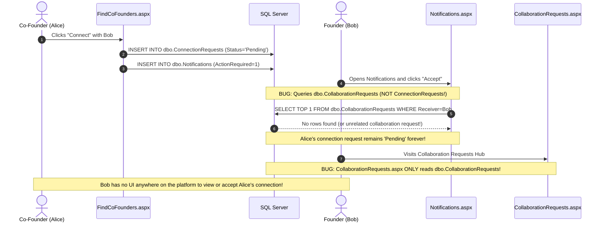

# FoundrLink: Comprehensive System Audit, Gaps & Flaws Analysis

> **Target Platform:** FoundrLink — Startup Founder & Co-Founder Matchmaking Platform  
> **Tech Stack:** ASP.NET Web Forms (.NET Framework 4.7.2 / 4.8), C#, Microsoft SQL Server, ADO.NET, Bootstrap 5  
> **Audit Date:** November 2026  
> **Convention:** All sample domains and emails strictly adhere to `@ripaldesign.studio`  

---

## Executive Summary

FoundrLink is built as an enterprise matchmaking and discovery platform enabling startup founders to recruit co-founders, discover early-stage ventures, form cross-functional teams, and exchange direct messages. 

While the baseline application compiles cleanly and implements essential security primitives (such as PBKDF2 password hashing, anti-CSRF ViewStateUserKey tokens, and parameterized SQL queries), a deep architectural and functional audit revealed **critical operational flaws, decoupled services, database schema divergence, broken collaboration workflows, and significant domain gaps** specific to the co-founder matching experience.

This document details all identified gaps, classified by architectural severity, along with concrete root cause analysis and a step-by-step remediation roadmap.

```
┌────────────────────────────────────────────────────────────────────────┐
│                        Audit Findings at a Glance                      │
├────────────────────────────────┬───────────────────────────────────────┤
│ 🚨 Critical Runtime Crash       │ StartupService SQL queries non-existent│
│                                │ columns ('FullPitch', 'PitchDeckUrl') │
├────────────────────────────────┼───────────────────────────────────────┤
│ ⚠️ Layering & Decoupling Flaws │ Web Forms bypass Services/Repositories│
│                                │ MatchmakingEngine is completely unused│
├────────────────────────────────┼───────────────────────────────────────┤
│ 💥 Critical Workflow Bugs      │ Notifications: Blind acceptance logic │
│                                │ & bulk decline of all pending requests│
├────────────────────────────────┼───────────────────────────────────────┤
│ 🗄️ Database Divergence         │ 5 pairs of redundant/parallel tables   │
│                                │ ('ConnectionRequests' vs 'CollabReqs')│
├────────────────────────────────┼───────────────────────────────────────┤
│ 🤝 Co-Founder Domain Gaps      │ No UI to edit skills/equity/runway;   │
│                                │ Founder disappears from team directory│
├────────────────────────────────┼───────────────────────────────────────┤
│ 🎨 UI/UX & Formatting Issues   │ Paging no-op; inert chat controls;    │
│                                │ Misaligned filters & fake hero stats  │
└────────────────────────────────┴───────────────────────────────────────┘
```

---

## 1. Critical Architectural Flaws & Bypassed Layers

### 1.1. Dual Domain Models & Fatal Runtime SQL Crash in `StartupService`
* **File Location:** [`Services/StartupService.cs`](file:///d:/dotnet/Foundrlink_new/FoundrLink/Services/StartupService.cs#L54-L65) and [`Models/Startup.cs`](file:///d:/dotnet/Foundrlink_new/FoundrLink/Models/Startup.cs#L5-L32)
* **The Flaw:**
  The solution contains two competing entity classes named `Startup`:
  1. `FoundrLink.Models.Startup` (contains `FullPitch`, `PitchDeckUrl`, etc.)
  2. `FoundrLink.Core.Models.Startup` (contains `FullDescription`, `Problem`, `Solution`, `Commitment`, `FoundedYear`, `MRR`)
  
  In [`Services/StartupService.cs`](file:///d:/dotnet/Foundrlink_new/FoundrLink/Services/StartupService.cs#L54-L65), `GetStartupById()` issues the following query:
  ```csharp
  SELECT s.StartupId, s.FounderId, s.Name, s.Tagline, s.Industry, s.Stage, s.LogoUrl, 
         s.ShortDescription, s.FullPitch, s.PitchDeckUrl, s.WebsiteUrl, s.Location, 
         s.TeamSize, s.FundingRaised, s.FundingGoal, s.RequiredSkills, s.Status, 
         s.CreatedAt, s.UpdatedAt,
         u.FullName AS FounderName, u.Title AS FounderTitle, u.AvatarUrl AS FounderAvatar
  FROM dbo.Startups s
  LEFT JOIN dbo.Users u ON s.FounderId = u.UserId
  WHERE s.StartupId = @Id
  ```
  Neither `FullPitch` nor `PitchDeckUrl` exist in the database table [`dbo.Startups`](file:///d:/dotnet/Foundrlink_new/FoundrLink/Database/FoundrLink_Schema_And_Seed.sql#L90). Calling this method immediately throws an unhandled `System.Data.SqlClient.SqlException: Invalid column name 'FullPitch'`.
* **Root Cause:**
  This crash was masked during runtime testing because **none** of the Web Forms UI pages call `StartupService.GetStartupById()`. Every page bypasses the service layer and executes custom ad-hoc inline SQL via `DbHelper`.

---

### 1.2. Complete Bypass of Business Logic & Service Tier (Layering Violation)
* **File Locations:**
  - [`ExploreStartups.aspx.cs`](file:///d:/dotnet/Foundrlink_new/FoundrLink/ExploreStartups.aspx.cs#L29-L88)
  - [`ManageStartup.aspx.cs`](file:///d:/dotnet/Foundrlink_new/FoundrLink/ManageStartup.aspx.cs#L43-L73)
  - [`StartupDetails.aspx.cs`](file:///d:/dotnet/Foundrlink_new/FoundrLink/StartupDetails.aspx.cs#L50-L144)
  - [`TeamDetails.aspx.cs`](file:///d:/dotnet/Foundrlink_new/FoundrLink/TeamDetails.aspx.cs#L41-L124)
  - [`Profile.aspx.cs`](file:///d:/dotnet/Foundrlink_new/FoundrLink/Profile.aspx.cs#L45-L210)
  - [`CollaborationRequests.aspx.cs`](file:///d:/dotnet/Foundrlink_new/FoundrLink/CollaborationRequests.aspx.cs#L83-L135)
* **The Flaw:**
  The project established abstractions such as `IStartupService`, `IStartupRepository`, and `StartupRepository`. However, none of the presentation Web Forms consume them. Instead, every code-behind directly calls `DbHelper.ExecuteDataTable()`, executing raw queries inside `Page_Load` and button event handlers.
* **Impact:**
  - Business rules cannot be tested independently through unit tests.
  - SQL schema changes require updating queries copy-pasted across 6+ different `.aspx.cs` files.
  - Encapsulation is broken, directly violating the multi-tier enterprise architecture specification.

---

### 1.3. Decoupled and Unused `MatchmakingEngine`
* **File Location:** [`Core/Services/MatchmakingEngine.cs`](file:///d:/dotnet/Foundrlink_new/FoundrLink/Core/Services/MatchmakingEngine.cs#L17-L278)
* **The Flaw:**
  `MatchmakingEngine.cs` contains an elaborate matching engine that evaluates:
  - Skill alignment weighting (50%)
  - Industry affinity graph lookups (30%)
  - Stage fit compatibility (20%)
  - FIFO evaluation queue (`Queue<Startup>`)
  - LIFO profile navigation stack (`Stack<string>`)
  
  **The Reality:** The engine is never invoked by any user-facing page.
  - In [`FindCoFounders.aspx.cs`](file:///d:/dotnet/Foundrlink_new/FoundrLink/FindCoFounders.aspx.cs#L217-L230), `CalculateMatchScore()` uses a hardcoded keyword check:
    ```csharp
    string[] keywords = { "react", "python", "typescript", "architecture", "c#", "node", "figma", "ai", "cloud" };
    ```
  - In [`Dashboard.aspx.cs`](file:///d:/dotnet/Foundrlink_new/FoundrLink/Dashboard.aspx.cs#L229-L251), `GetMatchPercent()` returns static percentages (`94%`, `88%`, `78%`, `82%`) based solely on role strings.
* **Impact:** Co-founders are presented with naive, arbitrary match scores rather than genuine algorithmic affinity.

---

## 2. Broken Collaboration & Connection Workflows



### 2.1. Blind Notification Acceptance & Bulk Decline Flaw in `Notifications.aspx`
* **File Location:** [`Notifications.aspx.cs`](file:///d:/dotnet/Foundrlink_new/FoundrLink/Notifications.aspx.cs#L138-L260)
* **Blind Acceptance (Lines 161–168):**
  When a user clicks "Accept" on any notification, the code executes:
  ```csharp
  SELECT TOP 1 cr.RequestId, cr.SenderUserId, cr.StartupId, s.Name AS StartupName, u.FullName AS SenderName
  FROM dbo.CollaborationRequests cr
  JOIN dbo.Startups s ON cr.StartupId = s.StartupId
  JOIN dbo.Users u ON cr.SenderUserId = u.UserId
  WHERE cr.ReceiverUserId = @UserId AND cr.Status = 'Pending'
  ORDER BY cr.RequestId DESC
  ```
  The code does **not** inspect or join the specific notification ID (`notifId`) that was clicked. If a founder has received 3 requests and clicks "Accept" on Request #1, the system blindly accepts whichever pending collaboration request was logged most recently.
* **Indiscriminate Bulk Decline (Lines 247–251):**
  When a user clicks "Decline" on a single notification item:
  ```csharp
  string sql = @"
      UPDATE dbo.Notifications SET IsRead = 1, ActionRequired = 0 WHERE NotificationId = @Id AND UserId = @UserId;
      UPDATE dbo.CollaborationRequests SET Status = 'Declined' WHERE ReceiverUserId = @UserId AND Status = 'Pending';
      UPDATE dbo.ConnectionRequests SET Status = 'Declined' WHERE ReceiverId = @UserId AND Status = 'Pending';";
  ```
  Declining one alert silently **declines all pending collaboration requests and all pending connection requests across the user's entire account**.

---

### 2.2. The Dual-Request Paradigm Trap (`ConnectionRequests` vs `CollaborationRequests`)
* **File Locations:**
  - [`FindCoFounders.aspx.cs`](file:///d:/dotnet/Foundrlink_new/FoundrLink/FindCoFounders.aspx.cs#L173-L180)
  - [`Profile.aspx.cs`](file:///d:/dotnet/Foundrlink_new/FoundrLink/Profile.aspx.cs#L236-L242)
  - [`Dashboard.aspx.cs`](file:///d:/dotnet/Foundrlink_new/FoundrLink/Dashboard.aspx.cs#L185-L189)
  - [`CollaborationRequests.aspx.cs`](file:///d:/dotnet/Foundrlink_new/FoundrLink/CollaborationRequests.aspx.cs#L83-L102)
* **The Flaw:**
  The platform maintains two separate request tables:
  1. `dbo.CollaborationRequests` (User-to-Startup requests sent from `StartupDetails.aspx`)
  2. `dbo.ConnectionRequests` (Peer-to-peer founder requests sent from `FindCoFounders.aspx`, `Profile.aspx`, and `Dashboard.aspx`)
* **The Disconnect:**
  - [`CollaborationRequests.aspx`](file:///d:/dotnet/Foundrlink_new/FoundrLink/CollaborationRequests.aspx) **only** queries and manages `dbo.CollaborationRequests`.
  - There is **no UI view or screen anywhere in the application** for a recipient to view, accept, decline, or manage pending `dbo.ConnectionRequests`.
  - If a recipient receives a connection notification and clicks "Accept" in `Notifications.aspx`, the backend checks `dbo.CollaborationRequests`. Since no collaboration request exists for a peer connect, `senderUserId` resolves to `0`, nothing is written to `dbo.Connections`, and the connection is never established.

---

### 2.3. Status Enum Desynchronization (`'Connected'` vs `'Accepted'`)
* **File Locations:**
  - [`CollaborationRequests.aspx.cs`](file:///d:/dotnet/Foundrlink_new/FoundrLink/CollaborationRequests.aspx.cs#L240)
  - [`Notifications.aspx.cs`](file:///d:/dotnet/Foundrlink_new/FoundrLink/Notifications.aspx.cs#L219)
  - [`Dashboard.aspx.cs`](file:///d:/dotnet/Foundrlink_new/FoundrLink/Dashboard.aspx.cs#L71-L75)
* **The Flaw:**
  When a request is accepted in `CollaborationRequests.aspx` or `Notifications.aspx`:
  ```sql
  INSERT INTO dbo.Connections (RequesterUserId, ReceiverUserId, Status, CreatedAt)
  VALUES (@U1, @U2, 'Connected', SYSUTCDATETIME());
  ```
  However, the user's dashboard metrics counter in [`Dashboard.aspx.cs`](file:///d:/dotnet/Foundrlink_new/FoundrLink/Dashboard.aspx.cs#L71-L75) queries:
  ```sql
  SELECT COUNT(1) FROM dbo.Connections 
  WHERE (RequesterUserId = @UserId OR ReceiverUserId = @UserId) AND Status = 'Accepted'
  ```
* **Impact:** Because `'Connected' != 'Accepted'`, valid accepted connections are **never reflected** in the user's active connections KPI count.

---

### 2.4. Open Positions Broken in `ManageStartup.aspx`
* **File Location:** [`ManageStartup.aspx.cs`](file:///d:/dotnet/Foundrlink_new/FoundrLink/ManageStartup.aspx.cs#L234-L245)
* **The Flaws:**
  1. **Insertion Bug:** The UI helper text states: *"Add roles (separated by commas or newlines)"*. But in `ManageStartup.aspx.cs`:
     ```csharp
     INSERT INTO dbo.OpenPositions (StartupId, Title, Location, PositionType, CreatedAt)
     VALUES (@StartupId, @Title, @Location, 'Full-time', SYSUTCDATETIME());
     ```
     It passes `txtOpenRole.Text.Trim()` directly as `@Title` without tokenizing commas or newlines, storing the entire multi-role paragraph as a single messy position record.
  2. **Edit Mode Bug:** When editing an existing startup (`_startupId.HasValue`):
     - `LoadStartupData()` **never loads** existing open positions from `dbo.OpenPositions` into `txtOpenRole`.
     - `SaveStartup()` **completely ignores** `txtOpenRole` when updating an existing startup. Any modifications to open positions during startup editing are silently discarded.

---

### 2.5. Founder Omitted From `dbo.TeamMembers` (Disappearing Founder Bug)
* **File Locations:**
  - [`ManageStartup.aspx.cs`](file:///d:/dotnet/Foundrlink_new/FoundrLink/ManageStartup.aspx.cs#L209-L232)
  - [`TeamDetails.aspx.cs`](file:///d:/dotnet/Foundrlink_new/FoundrLink/TeamDetails.aspx.cs#L88-L95)
* **The Flaw:**
  When a founder creates a startup, `ManageStartup.aspx.cs` inserts into `dbo.Startups`, but **fails to insert the creator into `dbo.TeamMembers`**.
  
  In [`TeamDetails.aspx.cs`](file:///d:/dotnet/Foundrlink_new/FoundrLink/TeamDetails.aspx.cs#L88-L95):
  ```csharp
  if (dtMembers.Rows.Count == 0)
  {
      // Fallback to founder
      membersQuery = "SELECT UserId, FullName AS Name, Title AS Role, AvatarUrl FROM dbo.Users WHERE UserId = @FounderId";
      dtMembers = DbHelper.ExecuteDataTable(membersQuery, DbHelper.CreateParam("@FounderId", SqlDbType.Int, _founderId));
  }
  ```
* **The Bug:** As long as no one has joined, the fallback shows the founder. The instant a co-founder joins the startup (`dtMembers.Rows.Count > 0`), the fallback condition evaluates to `false`. **The original founder completely vanishes from their own team directory.**

---

## 3. Co-Founder & Startup Platform Domain Gaps

```
┌────────────────────────────────────────────────────────────────────────┐
│                   Core Co-Founder Matchmaking Needs                    │
├──────────────────────────┬──────────────────────────┬──────────────────┤
│ 1. Skill Profile         │ 2. Role Application      │ 3. Traction Info │
│ • Can Offer / Looking For│ • Apply to specific role │ • Funding goal   │
│ • Availability & Runway  │ • Role-specific note     │ • Capital raised │
│ • Equity expectations    │ • Equity alignment       │ • MRR & stage    │
├──────────────────────────┼──────────────────────────┼──────────────────┤
│ ❌ NOT EDITABLE in UI    │ ❌ ONLY GENERIC JOIN REQ │ ❌ MISSING INPUTS│
└──────────────────────────┴──────────────────────────┴──────────────────┘
```

### 3.1. Inability to Edit Co-Founder Attributes
* **The Gap:** A co-founder matching platform relies on pairing complementary skill sets (e.g. Technical CTO + Growth Marketer) and aligning on availability and equity.
* **The Reality:** In [`Settings.aspx.cs`](file:///d:/dotnet/Foundrlink_new/FoundrLink/Settings.aspx.cs#L49-L56), users can only modify `FullName`, `Email`, `Title`, `Company`, `Location`, `Bio`, and `AvatarUrl`.
  The underlying columns in `dbo.FounderProfiles`:
  - `Skills`
  - `ICanOffer`
  - `LookingFor`
  - `Availability` (Full-time, Part-time, Side Hustle)
  - `Interests`
  
  have **no input fields in `Settings.aspx`**. Once a user registers, they have no way to set or update what skills they bring or what they seek in a co-founder.

---

### 3.2. Missing Position-Specific Application Flow
* **The Gap:** Startups list open roles (e.g. "Lead AI Engineer", "Head of Business Development"). Applicants want to apply to a specific role with an explanation of why their background fits that position.
* **The Reality:** Both [`StartupDetails.aspx`](file:///d:/dotnet/Foundrlink_new/FoundrLink/StartupDetails.aspx#L125) and [`TeamDetails.aspx`](file:///d:/dotnet/Foundrlink_new/FoundrLink/TeamDetails.aspx#L100) only offer a single generic button ("Request to Join"). There is no option to attach a request to a specific `PositionId` or customize the application note per role.

---

### 3.3. Missing Financial & Traction Fields in `ManageStartup.aspx`
* **The Gap:** Investors and co-founders evaluate startups based on traction: Funding Raised, Funding Goal, MRR, Founded Year, and Equity Commitment.
* **The Reality:** The database schema [`dbo.Startups`](file:///d:/dotnet/Foundrlink_new/FoundrLink/Database/FoundrLink_Schema_And_Seed.sql#L90) supports `FundingRaised`, `FundingGoal`, `MRR`, `FoundedYear`, and `Commitment`, and [`StartupDetails.aspx`](file:///d:/dotnet/Foundrlink_new/FoundrLink/StartupDetails.aspx#L88) displays them. However, [`ManageStartup.aspx`](file:///d:/dotnet/Foundrlink_new/FoundrLink/ManageStartup.aspx) has **zero input fields** for any of these values. All user-created startups default to `0` or `NULL` metrics.

---

### 3.4. Lack of a "My Startups" Portfolio Management Hub
* **The Gap:** Serial founders frequently manage more than one venture or need to monitor status, traction, and team applicants across their portfolio.
* **The Reality:** In [`User.Master`](file:///d:/dotnet/Foundrlink_new/FoundrLink/User.Master#L61), the "Startups" sidebar link points directly to `~/ManageStartup.aspx` (the blank creation form). If a founder already owns startups, there is no list or overview page where they can select which venture to manage, view applicant metrics, or archive past projects.

---

## 4. Database Schema Redundancies & Divergence

The database schema in [`Database/FoundrLink_Schema_And_Seed.sql`](file:///d:/dotnet/Foundrlink_new/FoundrLink/Database/FoundrLink_Schema_And_Seed.sql) contains **5 pairs of parallel redundant tables** that evolved independently:

| Active Table Used in Code | Parallel / Orphaned Table | Consequence & Risk |
|---|---|---|
| `dbo.FounderProfiles` | `dbo.UserProfiles` | Profile data split between two tables; `UserProfiles` is completely unreferenced. |
| `dbo.OpenPositions` | `dbo.StartupOpenRoles` | Schema duplicates roles; [`Admin/ManageStartups.aspx.cs`](file:///d:/dotnet/Foundrlink_new/FoundrLink/Admin/ManageStartups.aspx.cs#L219-L220) must execute delete statements against both to avoid orphaned records. |
| `dbo.TeamMembers` | `dbo.StartupMembers` | Parallel team rosters; `TeamMembers` is used by UI, leaving `StartupMembers` as dead schema. |
| `dbo.ModerationReports` | `dbo.Reports` | `ModerationReports` is used by the admin desk; `dbo.Reports` remains orphaned. |
| `dbo.CollaborationRequests` | `dbo.ConnectionRequests` | UI handles requests inconsistently; peer connections have no management interface. |

---

## 5. UI / UX Flaws & Inert Controls

### 5.1. Broken Paging in `ExploreStartups.aspx`
* **File Location:** [`ExploreStartups.aspx.cs`](file:///d:/dotnet/Foundrlink_new/FoundrLink/ExploreStartups.aspx.cs#L116-L129)
* **The Flaw:**
  The pagination button handlers are stubs:
  ```csharp
  protected void btnPrevPage_Click(object sender, EventArgs e) => LoadStartups();
  protected void btnNextPage_Click(object sender, EventArgs e) => LoadStartups();
  protected void rptPager_ItemCommand(object source, RepeaterCommandEventArgs e) => LoadStartups();
  ```
  `LoadStartups()` does not calculate a `PageIndex` or append `OFFSET/FETCH` to the SQL query. Clicking page buttons simply re-queries and binds the exact same dataset without navigating.

---

### 5.2. Silently Hidden Candidates on `FindCoFounders.aspx`
* **File Locations:**
  - [`FindCoFounders.aspx`](file:///d:/dotnet/Foundrlink_new/FoundrLink/FindCoFounders.aspx#L126)
  - [`FindCoFounders.aspx.cs`](file:///d:/dotnet/Foundrlink_new/FoundrLink/FindCoFounders.aspx.cs#L81-L89)
* **The Flaw:**
  In `FindCoFounders.aspx`, `rbAvailFull` defaults to `Checked="true"`.
  On initial page load, `LoadFounders()` enforces:
  ```csharp
  if (rbAvailFull.Checked)
  {
      sb.Append(" AND (p.Availability = 'Full-time' OR p.Availability IS NULL)");
  }
  ```
  Any co-founder who registered as "Part-time" or "Side Hustle" is silently filtered out and invisible on initial page visit.

---

### 5.3. Filter Argument Mismatch on `FindCoFounders.aspx`
* **File Location:** [`FindCoFounders.aspx`](file:///d:/dotnet/Foundrlink_new/FoundrLink/FindCoFounders.aspx#L92)
* **The Flaw:**
  ```html
  <asp:LinkButton ID="btnSkillFintech" runat="server" ... CommandArgument="Fintech">Sales</asp:LinkButton>
  ```
  The button label displayed to the user is **"Sales"**, but its `CommandArgument` is `"Fintech"`. Clicking "Sales" filters candidates by Fintech rather than sales capabilities.

---

### 5.4. Human Name Placeholder for Startup Entity
* **File Location:** [`ManageStartup.aspx`](file:///d:/dotnet/Foundrlink_new/FoundrLink/ManageStartup.aspx#L72)
* **The Flaw:**
  The input for Startup Name specifies:
  ```html
  <asp:TextBox ID="txtName" runat="server" placeholder="e.g. Rita Sharma" />
  ```
  A personal human name is suggested for an organization/startup entity rather than a venture name (e.g. "Apex AI" or "HealthPulse").

---

### 5.5. Fabricated Public Metrics on `Default.aspx`
* **File Location:** [`Default.aspx.cs`](file:///d:/dotnet/Foundrlink_new/FoundrLink/Default.aspx.cs#L78-L90)
* **The Flaw:**
  The hero banner displays platform stats using arbitrary mathematical multipliers:
  ```csharp
  litStatFounders.Text = users >= 1000 ? users.ToString("N0") + "+" : (users * 50 + 1200).ToString("N0") + "+";
  litStatInvestors.Text = investors >= 100 ? investors.ToString("N0") + "+" : (investors * 25 + 850).ToString("N0") + "+";
  if (capital <= 0) capital = 42000000m; // Hardcoded default of ₹4.2Cr
  ```
  Instead of displaying authentic database aggregates, stats are multiplied by 50x and 25x with hardcoded baselines.

---

### 5.6. Inert Controls & Static Messaging in `Messages.aspx`
* **File Locations:**
  - [`Messages.aspx`](file:///d:/dotnet/Foundrlink_new/FoundrLink/Messages.aspx#L204-L215)
  - [`Messages.aspx.cs`](file:///d:/dotnet/Foundrlink_new/FoundrLink/Messages.aspx.cs#L78-L90)
* **The Flaws:**
  1. The attachment paperclip button is an inert UI placeholder with no file upload control or event handler.
  2. The input helper reads *"Press Enter to send, Shift+Enter for new line"*, but uses a standard single-line `<asp:TextBox>` without multiline rendering or JavaScript keyboard event interception.
  3. Messages do not update in real time. There is no client polling, timer, or WebSocket/SignalR connection; users must perform a full manual browser refresh to see incoming messages.
  4. When navigating to `Messages.aspx?partnerId=X` from an external profile, if no message history exists yet, the active partner is not rendered in the left-hand conversation threads list.

---

## 6. Strategic Remediation Roadmap

To bring FoundrLink to enterprise production standards, execute the following phased remediation:

```mermaid
flowchart TD
    subgraph Phase 1: Database & Model Reconciliation
        A1["Reconcile Models/Startup.cs with SQL schema"] --> A2["Drop 5 redundant tables (UserProfiles, StartupMembers, etc.)"]
        A2 --> A3["Standardize Connection Status to 'Connected'"]
    end

    subgraph Phase 2: Layering & Service Integration
        B1["Refactor Web Forms to consume IStartupService"] --> B2["Hook MatchmakingEngine into FindCoFounders & Dashboard"]
        B2 --> B3["Add unit tests verifying Service layer"]
    end

    subgraph Phase 3: Workflow & Logic Fixes
        C1["Fix Notifications.aspx Accept/Decline mapping"] --> C2["Build UI for ConnectionRequests in CollaborationRequests.aspx"]
        C2 --> C3["Auto-insert Founder into TeamMembers on startup creation"]
        C3 --> C4["Fix OpenPositions multi-role parsing and edit persistence"]
    end

    subgraph Phase 4: Co-Founder Domain Upgrades
        D1["Add Skills, Equity & Availability editing to Settings.aspx"] --> D2["Add Financial/Traction fields to ManageStartup.aspx"]
        D2 --> D3["Build 'My Startups' portfolio dashboard"]
        D3 --> D4["Add Role-specific 'Apply' workflow to open positions"]
    end

    Phase 1 --> Phase 2
    Phase 2 --> Phase 3
    Phase 3 --> Phase 4
```

### Action Items Checklist:

- [ ] **1. Fix `StartupService.cs` SQL Error:**
  Align [`Services/StartupService.cs`](file:///d:/dotnet/Foundrlink_new/FoundrLink/Services/StartupService.cs) and [`Models/Startup.cs`](file:///d:/dotnet/Foundrlink_new/FoundrLink/Models/Startup.cs) to match the actual database schema columns (`FullDescription`, `Problem`, `Solution`, `Commitment`, `FoundedYear`, `MRR`) and eliminate queries referencing `FullPitch` and `PitchDeckUrl`.

- [ ] **2. Correct Notification Resolution Logic:**
  Update [`Notifications.aspx.cs`](file:///d:/dotnet/Foundrlink_new/FoundrLink/Notifications.aspx.cs) so "Accept" and "Decline" operations accept a specific `RequestId` parameter or notification-linked reference rather than executing blanket `SELECT TOP 1` or global bulk `UPDATE` statements.

- [ ] **3. Unify Connection & Collaboration Requests:**
  Add a dedicated tab in [`CollaborationRequests.aspx`](file:///d:/dotnet/Foundrlink_new/FoundrLink/CollaborationRequests.aspx) to display and manage peer `ConnectionRequests`, or unify both request types under a single robust request table.

- [ ] **4. Preserve Founder in Team Roster:**
  Update `SaveStartup()` in [`ManageStartup.aspx.cs`](file:///d:/dotnet/Foundrlink_new/FoundrLink/ManageStartup.aspx.cs) to automatically insert the creating founder into `dbo.TeamMembers` with role `"Founder & CEO"`.

- [ ] **5. Enable Co-Founder Profile Editing:**
  Add form sections in [`Settings.aspx`](file:///d:/dotnet/Foundrlink_new/FoundrLink/Settings.aspx) allowing users to edit `Skills`, `ICanOffer`, `LookingFor`, `Availability`, and `Interests` in `dbo.FounderProfiles`.

- [ ] **6. Add Startup Traction & Financial Inputs:**
  Add input fields for `FundingRaised`, `FundingGoal`, `MRR`, `FoundedYear`, and `Commitment` to [`ManageStartup.aspx`](file:///d:/dotnet/Foundrlink_new/FoundrLink/ManageStartup.aspx) and persist them during insert and update.

- [ ] **7. Wire Real Matchmaking Engine:**
  Inject [`MatchmakingEngine`](file:///d:/dotnet/Foundrlink_new/FoundrLink/Core/Services/MatchmakingEngine.cs) into [`FindCoFounders.aspx.cs`](file:///d:/dotnet/Foundrlink_new/FoundrLink/FindCoFounders.aspx.cs) and [`Dashboard.aspx.cs`](file:///d:/dotnet/Foundrlink_new/FoundrLink/Dashboard.aspx.cs) so match scores reflect real profile affinities.

- [ ] **8. Fix UI Pagination & Filtering Bugs:**
  Implement true SQL pagination (`OFFSET @Offset ROWS FETCH NEXT @PageSize ROWS ONLY`) in [`ExploreStartups.aspx.cs`](file:///d:/dotnet/Foundrlink_new/FoundrLink/ExploreStartups.aspx.cs), fix the `"Sales"` button argument on [`FindCoFounders.aspx`](file:///d:/dotnet/Foundrlink_new/FoundrLink/FindCoFounders.aspx), and correct startup name placeholders.
