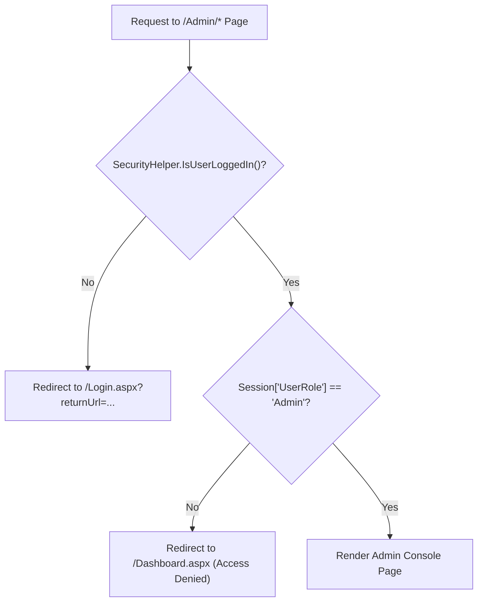
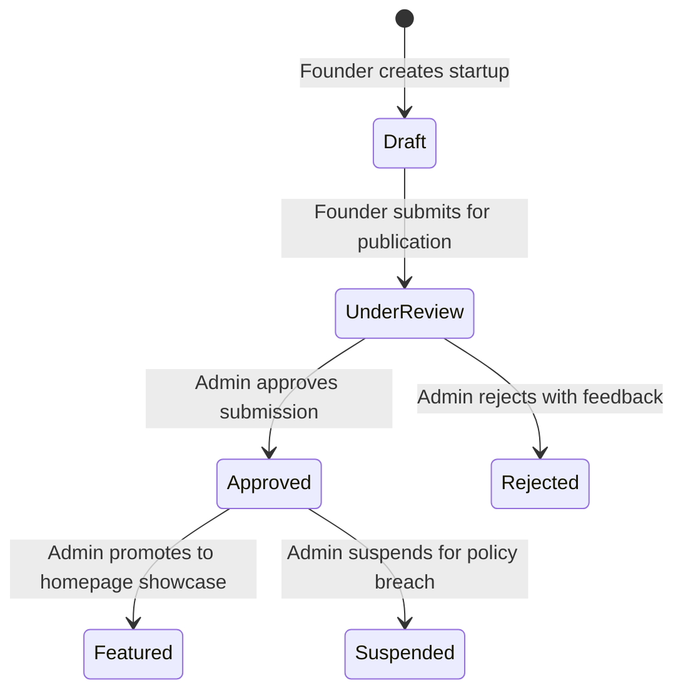

# Admin Console & Moderation

The FoundrLink Administration Console provides platform administrators with real-time operational oversight, user lifecycle control, startup approval queues, and violation ticket triage.

---

## 1. Administrative Architecture & Security Gating

All administration pages reside in the `/Admin/` directory and inherit from [`Admin.Master`](file:///D:/dotnet/Foundrlink_new/FoundrLink/Admin.Master).



### Security Enforcement in `Admin.Master.cs`:
```csharp
protected void Page_Init(object sender, EventArgs e)
{
    if (!SecurityHelper.IsUserLoggedIn())
    {
        Response.Redirect("~/Login.aspx?returnUrl=" + Server.UrlEncode(Request.RawUrl));
        return;
    }

    string role = Session["UserRole"]?.ToString();
    if (!string.Equals(role, "Admin", StringComparison.OrdinalIgnoreCase))
    {
        // Non-admin logged in user attempting to access admin portal
        Response.Redirect("~/Dashboard.aspx?error=unauthorized");
    }
}
```

---

## 2. Admin Operational Dashboard (`Admin/Dashboard.aspx`)

The administrative dashboard provides live telemetry across platform activity:

### Key Performance Indicator (KPI) Metric Cards:
| KPI Card | Metric Source | Database Query |
|---|---|---|
| **Total Registered Users** | Platform scale | `SELECT COUNT(1) FROM dbo.Users` |
| **Active Startups** | Verified ventures | `SELECT COUNT(1) FROM dbo.Startups WHERE Status = 'Active'` |
| **Pending Approvals** | Moderation backlog | `SELECT COUNT(1) FROM dbo.Startups WHERE Status = 'Under Review'` |
| **Open Moderation Reports** | Compliance alerts | `SELECT COUNT(1) FROM dbo.ModerationReports WHERE Status = 'Pending'` |

### Recent Platform Activity Stream:
Displays registration milestones, startup submissions, and flag alerts in chronological order with quick-action links.

---

## 3. User Management Console (`Admin/ManageUsers.aspx`)

The User Management console allows administrators to audit all accounts registered on the platform:

### Core Capabilities:
- **Search & Filtering:** Search by name or email; filter by role (`All`, `Founder`, `Investor`, `Co-Founder`, `Admin`) and status (`Active`, `Pending`, `Suspended`).
- **Account Status Toggles:**
  - **Activate:** Restores access for suspended or pending accounts.
  - **Suspend:** Instantly revokes session access and prevents future logins (`Status = 'Suspended'`).
- **Role Assignment:** Elevates or alters user roles.
- **Verification Badge Granting:** Sets `IsVerified = 1`, displaying the official verified checkmark across the platform.

---

## 4. Startup Moderation & Approval Queue (`Admin/ManageStartups.aspx`)

To preserve pitch quality and eliminate spam, all newly submitted startups enter an administrative review pipeline:



### Administrative Actions:
1. **Approve:** Updates status to `Active`, notifying the founder and publishing the venture to `/ExploreStartups.aspx`.
2. **Reject:** Updates status to `Rejected`, prompting the founder to revise submission details.
3. **Toggle Featured:** Promotes high-traction startups directly to the public showcase on the homepage (`Default.aspx`).

---

## 5. Violation Ticket Moderation (`Admin/Reports.aspx`)

User reports submitted regarding suspicious claims, fraudulent profiles, or abusive communications are processed in the Moderation Center:

### Ticket Fields Tracked:
- **Report Code:** Unique identifier (e.g., `#RPT-001`, `#RPT-002`).
- **Reporter Email:** Contact of reporting user.
- **Reported Item / Subject:** Name of startup, user, or message excerpt under review.
- **Category:** `Spam`, `Content Violation`, or `Suspicious Activity`.
- **Priority Indicator:** Visual badge for `High` (Red), `Medium` (Amber), `Low` (Gray).
- **Status:** `Pending`, `Resolved`, `Dismissed`.

### Resolution Workflow:
Selecting a report opens a resolution modal enabling the administrator to:
- **Dismiss:** Mark as invalid/false flag (`Status = 'Dismissed'`).
- **Resolve:** Confirm remediation action taken (`Status = 'Resolved'`).
- **Take Enforcement Action:** Directly suspend the reported user or unpublish the offending startup in a single click.

---

> [!TIP]
> To understand the underlying cryptographic and data security guarantees, see **[Security & State Management](Security-and-State-Management)**.
