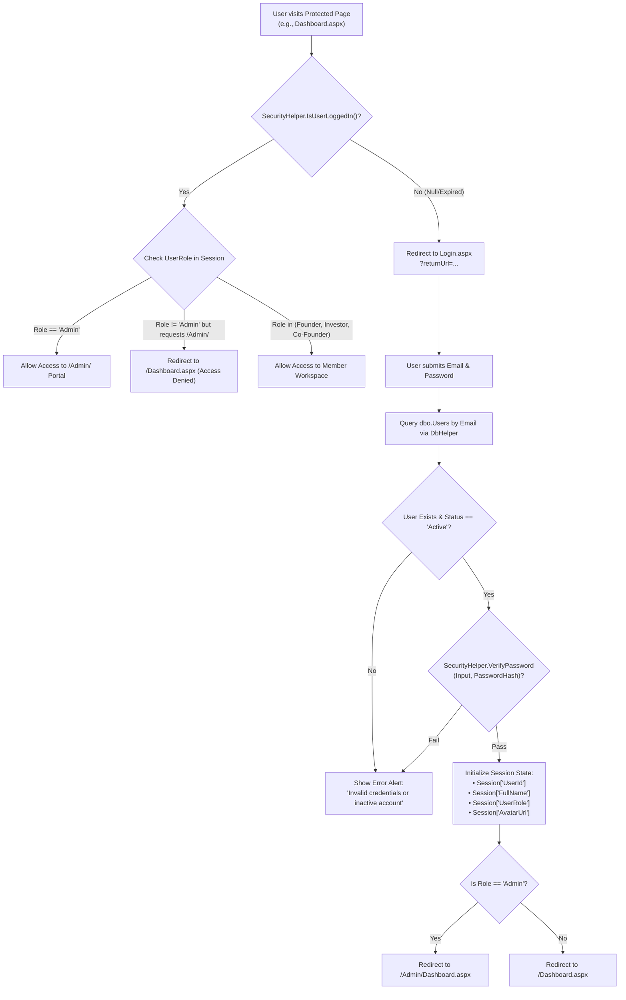

# Authentication & Role Workflows

FoundrLink implements a secure, role-based authentication and authorization architecture designed around ASP.NET Session State, PBKDF2 password cryptography, and strict access gating across user portals.

---

## 1. Authentication Lifecycle Flowchart



---

## 2. User Registration Workflow (`Register.aspx`)

### Registration Form Controls:
- **Full Name:** Text input (`asp:TextBox ID="txtFullName"`), validated by `RequiredFieldValidator`.
- **Email Address:** Text input (`asp:TextBox ID="txtEmail"`), validated by `RegularExpressionValidator` to guarantee RFC-compliant email syntax.
- **Password:** Password mask (`asp:TextBox ID="txtPassword" TextMode="Password"`), minimum 8 characters with alphanumeric enforcement.
- **Role Selection:** Dropdown (`asp:DropDownList ID="ddlRole"`):
  - `Founder` (Default)
  - `Co-Founder` / Technical Builder
  - `Investor` / Capital Allocator
- **Location & Bio:** Geographic location and professional summary.

### Code-Behind Execution (`Register.aspx.cs`):
```csharp
protected void btnRegister_Click(object sender, EventArgs e)
{
    if (!Page.IsValid) return;

    string email = txtEmail.Text.Trim().ToLowerInvariant();
    string rawPassword = txtPassword.Text;
    
    // Check if email already registered
    string checkQuery = "SELECT COUNT(1) FROM dbo.Users WHERE Email = @Email";
    int count = Convert.ToInt32(DbHelper.ExecuteScalar(checkQuery, 
        DbHelper.CreateParam("@Email", SqlDbType.NVarChar, email)));

    if (count > 0)
    {
        lblError.Text = "An account with this email address already exists.";
        lblError.Visible = true;
        return;
    }

    // Cryptographically hash password with salt
    string passwordHash = SecurityHelper.HashPassword(rawPassword);

    // Insert user record with parameterized query
    string insertUser = @"
        INSERT INTO dbo.Users (FullName, Email, PasswordHash, Role, Location, Bio, Status, CreatedAt)
        VALUES (@FullName, @Email, @PasswordHash, @Role, @Location, @Bio, 'Active', SYSUTCDATETIME());
        SELECT SCOPE_IDENTITY();";

    object newIdObj = DbHelper.ExecuteScalar(insertUser,
        DbHelper.CreateParam("@FullName", SqlDbType.NVarChar, txtFullName.Text.Trim()),
        DbHelper.CreateParam("@Email", SqlDbType.NVarChar, email),
        DbHelper.CreateParam("@PasswordHash", SqlDbType.NVarChar, passwordHash),
        DbHelper.CreateParam("@Role", SqlDbType.NVarChar, ddlRole.SelectedValue),
        DbHelper.CreateParam("@Location", SqlDbType.NVarChar, txtLocation.Text.Trim()),
        DbHelper.CreateParam("@Bio", SqlDbType.NVarChar, txtBio.Text.Trim())
    );

    int newUserId = Convert.ToInt32(newIdObj);

    // If registered as Founder or Co-Founder, seed initial profile
    if (ddlRole.SelectedValue == "Founder" || ddlRole.SelectedValue == "Co-Founder")
    {
        string initProfile = @"
            INSERT INTO dbo.FounderProfiles (UserId, PlatformImpactConnections, ProfileCompletionPercentage)
            VALUES (@UserId, 0, 75);";
        DbHelper.ExecuteNonQuery(initProfile, DbHelper.CreateParam("@UserId", SqlDbType.Int, newUserId));
    }

    Response.Redirect("~/Login.aspx?registered=true");
}
```

---

## 3. Member Login & Session Management (`Login.aspx`)

### Session Variables Initialized on Successful Sign-In:
| Session Variable | Type | Description |
|---|---|---|
| `Session["UserId"]` | `int` | Primary surrogate key of the authenticated user in `dbo.Users`. |
| `Session["FullName"]` | `string` | Display name rendered in header bars and welcome prompts. |
| `Session["UserEmail"]` | `string` | User's unique login email address. |
| `Session["UserRole"]` | `string` | Security role (`Admin`, `Founder`, `Investor`, `Co-Founder`). |
| `Session["AvatarUrl"]` | `string` | Profile image URL (falls back to default placeholder if null). |

### Password Verification Logic (`Login.aspx.cs`):
```csharp
protected void btnLogin_Click(object sender, EventArgs e)
{
    string email = txtEmail.Text.Trim().ToLowerInvariant();
    string rawPassword = txtPassword.Text;

    string query = @"
        SELECT UserId, FullName, PasswordHash, Role, AvatarUrl, Status 
        FROM dbo.Users 
        WHERE Email = @Email";

    DataTable dt = DbHelper.ExecuteDataTable(query, 
        DbHelper.CreateParam("@Email", SqlDbType.NVarChar, email));

    if (dt.Rows.Count == 1)
    {
        DataRow row = dt.Rows[0];
        string status = row["Status"].ToString();

        if (status.Equals("Suspended", StringComparison.OrdinalIgnoreCase) ||
            status.Equals("Inactive", StringComparison.OrdinalIgnoreCase))
        {
            lblError.Text = "Your account has been deactivated. Please contact support.";
            lblError.Visible = true;
            return;
        }

        string storedHash = row["PasswordHash"].ToString();

        // Verify password against salt
        if (SecurityHelper.VerifyPassword(rawPassword, storedHash))
        {
            // Establish authenticated session
            Session["UserId"] = Convert.ToInt32(row["UserId"]);
            Session["FullName"] = row["FullName"].ToString();
            Session["UserEmail"] = email;
            string role = row["Role"].ToString();
            Session["UserRole"] = role;
            Session["AvatarUrl"] = row["AvatarUrl"] != DBNull.Value ? row["AvatarUrl"].ToString() : "";

            // Role-based destination routing
            if (role.Equals("Admin", StringComparison.OrdinalIgnoreCase))
            {
                Response.Redirect("~/Admin/Dashboard.aspx");
            }
            else
            {
                Response.Redirect("~/Dashboard.aspx");
            }
            return;
        }
    }

    lblError.Text = "Invalid email or password. Please try again.";
    lblError.Visible = true;
}
```

---

## 4. Role-Based Access Control (RBAC) Matrix

| Feature / Page Path | Anonymous Visitor | Founder | Co-Founder | Investor | Administrator |
|---|:---:|:---:|:---:|:---:|:---:|
| `Default.aspx` (Public Showcase) | Read | Read | Read | Read | Read |
| `Login.aspx` / `Register.aspx` | Full | - | - | - | - |
| `Dashboard.aspx` (Member Portal) | Blocked | Full | Full | Full | Full |
| `ExploreStartups.aspx` | Read | Read | Read | Read | Read |
| `StartupDetails.aspx` | Read | Read | Read | Read | Read |
| `ManageStartup.aspx` (Create/Edit) | Blocked | Full | View/Edit (if team) | Blocked | Full |
| `FindCoFounders.aspx` | Blocked | Full | Full | Full | Full |
| `Profile.aspx` | Blocked | Full | Full | Full | Full |
| `Messages.aspx` (Threaded Chat) | Blocked | Full | Full | Full | Full |
| `Notifications.aspx` | Blocked | Full | Full | Full | Full |
| `Admin/Dashboard.aspx` | Blocked | Blocked | Blocked | Blocked | Full |
| `Admin/ManageUsers.aspx` | Blocked | Blocked | Blocked | Blocked | Full |
| `Admin/ManageStartups.aspx` | Blocked | Blocked | Blocked | Blocked | Full |
| `Admin/Reports.aspx` | Blocked | Blocked | Blocked | Blocked | Full |

---

## 5. Session Termination & Logout Workflow

Logout is accessible from the top navigation dropdown on `User.Master` and `Admin.Master`:

```csharp
protected void btnLogout_Click(object sender, EventArgs e)
{
    // Clear and terminate current session
    Session.Clear();
    Session.Abandon();

    // Expire session cookie
    if (Request.Cookies["ASP.NET_SessionId"] != null)
    {
        Response.Cookies["ASP.NET_SessionId"].Value = string.Empty;
        Response.Cookies["ASP.NET_SessionId"].Expires = DateTime.Now.AddMonths(-10);
    }

    // Redirect to login page
    Response.Redirect("~/Login.aspx?loggedOut=true");
}
```

---

> [!TIP]
> Now explore how founders list their ventures and discover investors in **[Startup Management & Discovery](Startup-Management-and-Discovery)**.
