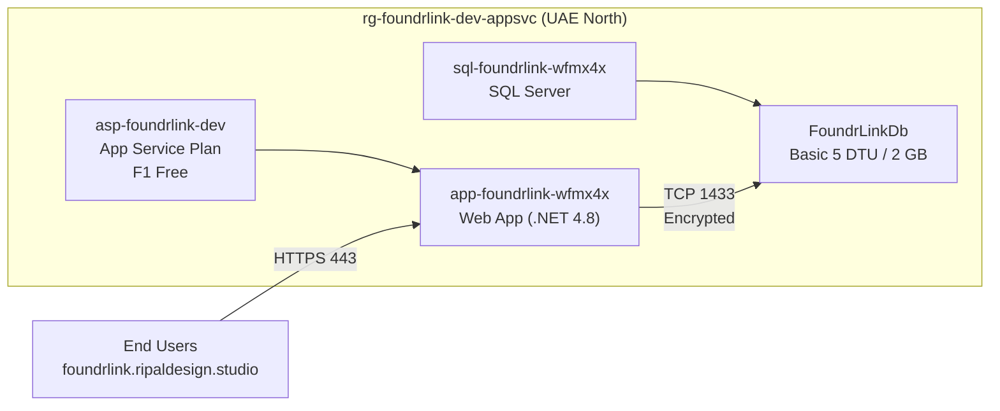

# Azure Infrastructure & Cost Report

> **Last Updated:** 12 November 2026
> **Subscription:** Azure for Students (`d0a8518b-6cc4-4d5d-9b7b-7bd99a98e235`)
> **Region:** UAE North
> **Resource Group:** `rg-foundrlink-dev-appsvc`

---

## 1. Resource Inventory

All FoundrLink cloud resources reside in a single resource group managed by Terraform.

| # | Resource Name | Azure Type | Tier / SKU | Status |
|---|---|---|---|---|
| 1 | `asp-foundrlink-dev` | App Service Plan | **F1 (Free)** | Active |
| 2 | `app-foundrlink-wfmx4x` | Web App (Windows, .NET 4.8) | Free (on above plan) | Running |
| 3 | `sql-foundrlink-wfmx4x` | SQL Server (logical) | — | Ready |
| 4 | `FoundrLinkDb` | SQL Database | **Basic (5 DTU, 2 GB)** | Online |
| 5 | `master` | System Database | — | Online |

---

## 2. Monthly Cost Breakdown

| Resource | SKU | Monthly Cost (USD) | Notes |
|---|---|---|---|
| App Service Plan (F1) | Free | **$0.00** | 60 CPU min/day, 1 GB RAM, no custom domains, no SSL |
| SQL Database (Basic) | Basic, 5 DTU | **~$4.90** | 2 GB max storage, geo-redundant backup |
| SQL Server (logical) | — | **$0.00** | No charge for the logical server |
| **Total** | | **~$4.90/month** | |

### Student Credit Budget

| Item | Value |
|---|---|
| Credit Allowance | **$100.00** (one-time, valid 12 months) |
| Current Monthly Burn | ~$4.90 |
| Estimated Runway | **~20 months** (exceeds credit validity) |

> [!IMPORTANT]
> The **F1 (Free)** App Service Plan does **not** support custom domain binding or SSL certificates. To enable `foundrlink.ripaldesign.studio`, upgrade to **B1 Basic** (~$13.16/month), which brings the total to ~$18/month and ~5-6 months of runway on student credits.

---

## 3. Custom Domain Configuration

### Current State

| Hostname | Type | Status |
|---|---|---|
| `app-foundrlink-wfmx4x.azurewebsites.net` | Default | ✅ Enabled |
| `foundrlink.ripaldesign.studio` | Custom (CNAME) | ⚠️ Verified but not enabled (requires B1+ plan) |

### DNS Configuration (Cloudflare)

| Record Type | Name | Target | Proxy |
|---|---|---|---|
| CNAME | `foundrlink` | `app-foundrlink-wfmx4x.azurewebsites.net` | DNS Only (grey cloud) |

### Steps to Fully Enable

1. Upgrade App Service Plan to B1: `az appservice plan update -n asp-foundrlink-dev -g rg-foundrlink-dev-appsvc --sku B1`
2. Custom domain will auto-activate (already verified and bound)
3. Add free managed SSL certificate via Azure Portal → Custom domains → Add binding
4. Optionally re-enable Cloudflare proxy (orange cloud) for CDN/WAF

---

## 4. Azure Tags

All resources are tagged for governance:

| Tag | Value |
|---|---|
| `Application` | FoundrLink |
| `Environment` | dev |
| `ManagedBy` | Terraform |
| `Tier` | Free-Compute-Ultra-Low-Cost |

---

## 5. Scaling Recommendations

| Scenario | Recommended Change | Cost Impact |
|---|---|---|
| Enable custom domain + SSL | Upgrade to **B1 Basic** | +$13.16/month |
| Higher DB performance | Upgrade to **S0 Standard (10 DTU)** | +$10.10/month |
| Production readiness | B1 + S0 + Managed Identity | ~$28/month total |
| Demo/presentation only | Stay on F1 + Basic SQL | ~$4.90/month |

> [!TIP]
> Monitor your remaining credit at [Azure Sponsorship Balance](https://www.microsoftazuresponsorships.com/Balance) or via Azure Portal → Subscriptions → Azure for Students → Usage + quotas.
