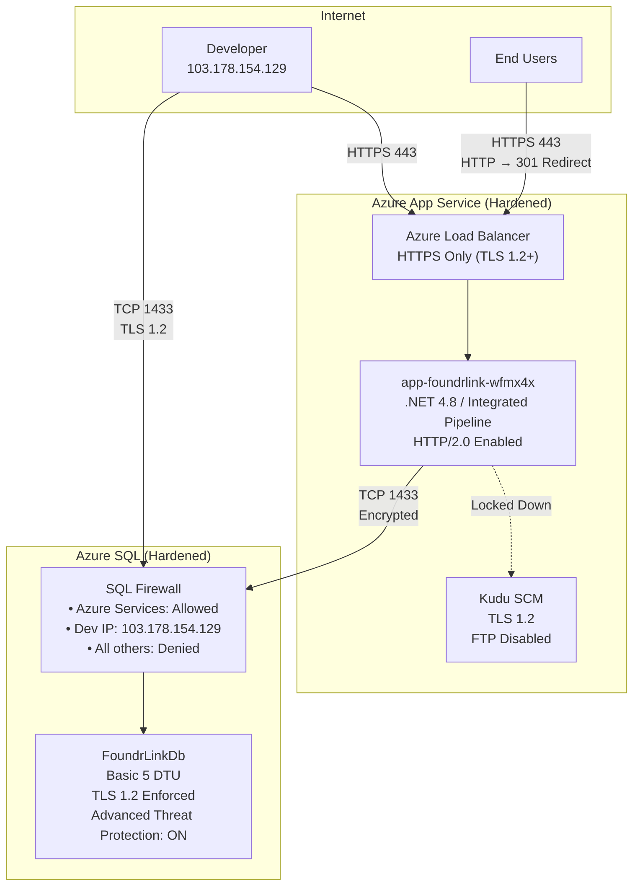

# Azure Security Hardening

> **Last Updated:** 12 November 2026
> **Applied By:** Automated hardening via Azure CLI
> **Scope:** All resources in `rg-foundrlink-dev-appsvc`

---

## 1. Security Audit Summary

The following hardening measures were audited and applied on 12 November 2026.

### App Service (`app-foundrlink-wfmx4x`)

| Security Control | Before | After | Status |
|---|---|---|---|
| HTTPS Only | `false` | **`true`** | ✅ Fixed |
| HTTP/2.0 | `false` | **`true`** | ✅ Fixed |
| Minimum TLS Version | `1.2` | `1.2` | ✅ Already Compliant |
| FTP/FTPS State | `Disabled` | `Disabled` | ✅ Already Compliant |
| Remote Debugging | `false` | `false` | ✅ Already Compliant |
| PHP Runtime | `5.6` (enabled) | **`off`** | ✅ Fixed (not needed for .NET) |
| SCM (Kudu) TLS | `1.2` | `1.2` | ✅ Already Compliant |
| Pipeline Mode | `Integrated` | `Integrated` | ✅ Already Compliant |

### SQL Server (`sql-foundrlink-wfmx4x`)

| Security Control | Before | After | Status |
|---|---|---|---|
| Minimum TLS Version | `1.2` | `1.2` | ✅ Already Compliant |
| Advanced Threat Protection | `Disabled` | **`Enabled`** | ✅ Fixed |
| Auditing | `Disabled` | `Disabled` | ⚠️ Recommended (requires storage account) |
| Public Network Access | `Enabled` | `Enabled` | ℹ️ Required for student tier |

### SQL Firewall Rules

| Rule Name | IP Range | Purpose | Status |
|---|---|---|---|
| `AllowAzureServices` | `0.0.0.0 - 0.0.0.0` | Allows App Service → SQL connectivity | ✅ Required |
| `dev-access-dev-0` | `103.178.154.129` | Developer machine access | ✅ Scoped to single IP |
| ~~`current-machine`~~ | ~~`103.178.154.129`~~ | ~~Duplicate of dev-access-dev-0~~ | 🗑️ Removed |

---

## 2. Security Architecture



---

## 3. What Each Hardening Measure Does

### 3.1 HTTPS Only (`httpsOnly: true`)
All HTTP requests to the App Service are automatically **301 redirected** to HTTPS. No unencrypted traffic reaches the application.

### 3.2 HTTP/2.0 Enabled
Provides multiplexed connections, header compression, and improved latency over HTTP/1.1. Fully backward-compatible.

### 3.3 TLS 1.2 Minimum (App Service + SQL)
Blocks connections using deprecated TLS 1.0 and 1.1 protocols, which are vulnerable to POODLE and BEAST attacks.

### 3.4 FTP/FTPS Disabled
FTP transmits credentials in plaintext. FTPS is legacy. Both are disabled — deployments use Azure CLI, Visual Studio Publish, or GitHub Actions only.

### 3.5 Remote Debugging Disabled
Remote debugging opens a port for Visual Studio attachment. Must remain **off** in any non-local environment.

### 3.6 PHP Runtime Disabled
The App Service had PHP 5.6 enabled by default. Since FoundrLink is a .NET 4.8 application, PHP is unnecessary and represents an attack surface.

### 3.7 SQL Advanced Threat Protection
Azure monitors for:
- **SQL Injection** attempts
- **Anomalous database access** patterns
- **Brute force** login attacks
- **Data exfiltration** indicators

Alerts are sent to the subscription admin email.

### 3.8 Duplicate Firewall Rule Cleanup
Two rules pointed to the same IP (`103.178.154.129`). The duplicate `current-machine` was removed to reduce confusion and maintain clean governance.

---

## 4. Remaining Recommendations

| Priority | Recommendation | Reason | Blocked By |
|---|---|---|---|
| 🟡 Medium | Enable SQL Auditing | Logs all DB operations for compliance | Requires Azure Storage account (~$1/month) |
| 🟡 Medium | Enable Managed Identity | Removes SQL password from connection string | Requires B1+ App Service plan |
| 🟢 Low | Restrict SCM access to dev IPs | Limits Kudu console access | Optional for student project |
| 🟢 Low | Add custom error pages | Prevents information leakage on errors | Application-level change |

---

## 5. CLI Commands Used

All hardening was applied via Azure CLI (`az` version 2.92.0):

```powershell
$env:PATH = "C:\Program Files\Microsoft SDKs\Azure\CLI2\wbin;" + $env:PATH

# App Service: Enforce HTTPS-only
az webapp update -n app-foundrlink-wfmx4x -g rg-foundrlink-dev-appsvc --https-only true

# App Service: Enable HTTP/2, enforce TLS 1.2
az webapp config set -n app-foundrlink-wfmx4x -g rg-foundrlink-dev-appsvc --http20-enabled true --min-tls-version 1.2

# App Service: Disable PHP
az webapp config set -n app-foundrlink-wfmx4x -g rg-foundrlink-dev-appsvc --php-version off

# SQL: Enforce TLS 1.2
az sql server update -n sql-foundrlink-wfmx4x -g rg-foundrlink-dev-appsvc --minimal-tls-version 1.2

# SQL: Enable Advanced Threat Protection
az sql db advanced-threat-protection-setting update -s sql-foundrlink-wfmx4x -g rg-foundrlink-dev-appsvc -n FoundrLinkDb --state Enabled

# SQL: Remove duplicate firewall rule
az sql server firewall-rule delete -s sql-foundrlink-wfmx4x -g rg-foundrlink-dev-appsvc -n current-machine
```

> [!CAUTION]
> Never commit Azure CLI credentials, connection strings, or passwords to the Git repository. Use Azure App Settings or Key Vault for secrets management.
