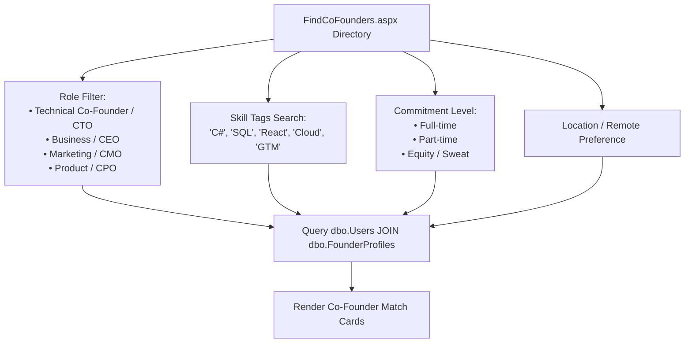
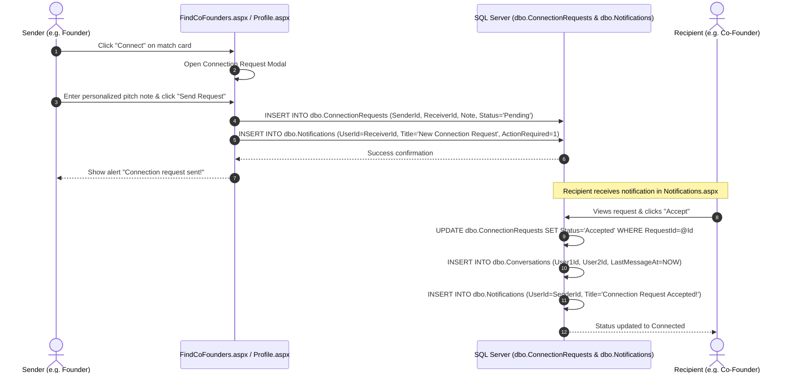

# Co-Founder Matchmaking & Profiles

FoundrLink's matchmaking engine addresses the primary cause of startup failure — team misalignment — by structuring co-founder exploration around explicit skill taxonomy, complementary capabilities, and verified availability.

---

## 1. Co-Founder Discovery Directory (`FindCoFounders.aspx`)

The `FindCoFounders.aspx` portal allows founders to discover compatible technical and business talent across multiple dimensions:



### Match Card Structure:
- **Header:** Full Name, Title, Verification Badge, and Avatar.
- **Location & Availability:** Geographic base and commitment badge (e.g. `Full-time`, `Part-time / Equity`).
- **Core Skill Tags:** Visual chips rendered from comma-delimited `Skills` column (e.g., `ASP.NET`, `SQL Server`, `Azure`, `System Architecture`).
- **Complementary Matrix Snippet:**
  - *I Can Offer:* Architecture design, database optimization, backend scaling.
  - *Looking For:* Commercial co-founder with SaaS sales background.
- **Action Buttons:** "View Profile" and "Connect" (triggers connection request modal).

---

## 2. Founder & Member Profile (`Profile.aspx`)

The `Profile.aspx` page serves as a verified professional portfolio tailored specifically for early-stage startup collaboration:

### Key Profile Sections:
1. **Hero Header:**
   - Avatar image, full name, professional title, and company.
   - Profile Completion Gauge (calculated metric from 0% to 100%).
   - Action buttons: "Edit Profile" (for owner) or "Send Message" / "Connect" (for visitors).
2. **Platform Impact Metrics Bar:**
   - Binds to `dbo.FounderProfiles` metrics:
     - 🤝 **Connections Made:** Total confirmed founder/co-founder matches.
     - 🚀 **Introductions Facilitated:** Investor introductions generated.
     - 👥 **Teams Formed:** Active startups co-founded through the platform.
     - ⏱️ **Hours Saved:** Efficiency metric based on automated discovery.
3. **Offerings & Needs Matrix:**
   - **"What I Can Offer":** Detailed technical or business competencies the user brings to a venture.
   - **"What I Am Looking For":** Explicit requirements for ideal co-founders or investors.
4. **Associated Startups:**
   - Queries `dbo.Startups` where `FounderId = @UserId` or `dbo.TeamMembers` where `UserId = @UserId`.

---

## 3. Connection Request Workflow

Connecting with a potential co-founder initiates a formal workflow tracked in `dbo.ConnectionRequests`:



### Database Persistence:
```csharp
public static bool SendConnectionRequest(int senderId, int receiverId, string note, int? startupId = null)
{
    string query = @"
        INSERT INTO dbo.ConnectionRequests (SenderId, ReceiverId, StartupId, Note, Status, CreatedAt)
        VALUES (@SenderId, @ReceiverId, @StartupId, @Note, 'Pending', SYSUTCDATETIME());

        INSERT INTO dbo.Notifications (UserId, Title, Message, NotificationType, ActionRequired, CreatedAt)
        VALUES (@ReceiverId, 'New Co-Founder Connection Request', @Note, 'Requests', 1, SYSUTCDATETIME());";

    int rows = DbHelper.ExecuteNonQuery(query,
        DbHelper.CreateParam("@SenderId", SqlDbType.Int, senderId),
        DbHelper.CreateParam("@ReceiverId", SqlDbType.Int, receiverId),
        DbHelper.CreateParam("@StartupId", SqlDbType.Int, (object)startupId ?? DBNull.Value),
        DbHelper.CreateParam("@Note", SqlDbType.NVarChar, note));

    return rows > 0;
}
```

---

> [!TIP]
> Once connected, users collaborate via private channels. See **[Messaging & Notifications](Messaging-and-Notifications)**.
