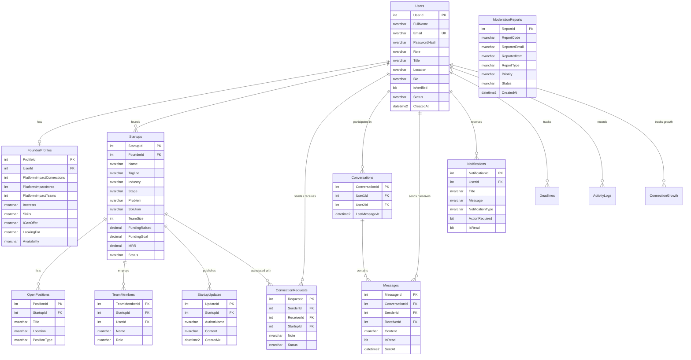

# Database Design & Data Dictionary

## 1. Database Architecture & Design Principles

FoundrLink's persistence layer is engineered on **Microsoft SQL Server (Transact-SQL)**. The database schema conforms strictly to **Third Normal Form (3NF)**, ensuring zero data redundancy, high transactional integrity, and optimized query performance.

### Key Architectural Characteristics:
- **Primary Keys:** Surrogate auto-incrementing integer identity keys (`INT IDENTITY(1,1) PRIMARY KEY`).
- **Referential Integrity:** Enforced foreign key constraints (`FOREIGN KEY REFERENCES ...`) across all related entities.
- **Cascade Delete Rules:** Configured on dependent child entities (e.g., deleting a startup automatically cascades to its `OpenPositions`, `TeamMembers`, and `StartupUpdates`).
- **Timestamps:** Standardized UTC audit timestamps using `DATETIME2 DEFAULT SYSUTCDATETIME()`.
- **String Columns:** Standardized on `NVARCHAR` to ensure universal Unicode support for multi-lingual and international content.

---

## 2. Entity-Relationship (ER) Diagram

---

## 3. Data Dictionary: Comprehensive Table Specifications

### 1. `dbo.Users`
Primary identity store for all system actors (Founders, Co-Founders, Investors, Administrators).

| Column | Data Type | Nullable | Default | Description |
|---|---|---|---|---|
| `UserId` | `INT IDENTITY(1,1)` | NO | PK | Unique identifier for the user |
| `FullName` | `NVARCHAR(200)` | NO | - | Full legal or display name |
| `Email` | `NVARCHAR(300)` | NO | - | Unique login email address |
| `PasswordHash` | `NVARCHAR(512)` | NO | - | Cryptographic PBKDF2 / SHA-256 password hash |
| `Role` | `NVARCHAR(100)` | NO | `'Founder'` | Role (`Founder`, `Investor`, `Co-Founder`, `Technical`, `Admin`) |
| `Title` | `NVARCHAR(200)` | YES | NULL | Professional title (e.g., "Full-Stack System Architect") |
| `Location` | `NVARCHAR(200)` | YES | NULL | Geographic location (e.g., "Bengaluru, India") |
| `Bio` | `NVARCHAR(MAX)` | YES | NULL | Personal narrative and professional background |
| `AvatarUrl` | `NVARCHAR(510)` | YES | NULL | Path to user profile image or external CDN URL |
| `Company` | `NVARCHAR(200)` | YES | NULL | Current employer or startup organization |
| `IsVerified` | `BIT` | NO | `0` | Platform verification badge status |
| `Status` | `NVARCHAR(100)` | NO | `'Active'` | Account state (`Active`, `Pending`, `Inactive`/`Suspended`) |
| `CreatedAt` | `DATETIME2` | NO | `SYSUTCDATETIME()` | Registration timestamp |
| `UpdatedAt` | `DATETIME2` | NO | `SYSUTCDATETIME()` | Last profile update timestamp |

---

### 2. `dbo.FounderProfiles`
Extended metadata profile for founders and talent showcasing skill portfolios and matchmaking criteria.

| Column | Data Type | Nullable | Default | Description |
|---|---|---|---|---|
| `ProfileId` | `INT IDENTITY(1,1)` | NO | PK | Unique profile identifier |
| `UserId` | `INT` | NO | FK | Foreign key to `dbo.Users(UserId)` (ON DELETE CASCADE) |
| `PlatformImpactConnections` | `INT` | NO | `0` | Total confirmed platform connections |
| `PlatformImpactIntros` | `INT` | NO | `0` | Total investor/co-founder introductions |
| `PlatformImpactTeams` | `INT` | NO | `0` | Number of startup teams formed |
| `PlatformImpactSaved` | `INT` | NO | `0` | Hours saved metric |
| `Interests` | `NVARCHAR(MAX)` | YES | NULL | Comma-separated or serialized interest topics |
| `Skills` | `NVARCHAR(MAX)` | YES | NULL | Comma-delimited skill tags (e.g., "C#, SQL, ASP.NET, Cloud") |
| `ICanOffer` | `NVARCHAR(MAX)` | YES | NULL | Value offerings (e.g., "Architecture design, Cloud deployment") |
| `LookingFor` | `NVARCHAR(MAX)` | YES | NULL | Desired co-founder attributes (e.g., "GTM specialist, Seed Capital") |
| `Availability` | `NVARCHAR(100)` | NO | `'Full-time'` | Commitment level (`Full-time`, `Part-time`, `Advisory`, `Equity`) |
| `BaseLocation` | `NVARCHAR(200)` | YES | NULL | Primary work base or remote preference |
| `ProfileCompletionPercentage` | `INT` | NO | `85` | Profile completion gauge score (0-100) |

---

### 3. `dbo.Startups`
Central catalog storing startup ventures, problem/solution propositions, and financial metrics.

| Column | Data Type | Nullable | Default | Description |
|---|---|---|---|---|
| `StartupId` | `INT IDENTITY(1,1)` | NO | PK | Unique startup identifier |
| `FounderId` | `INT` | NO | FK | Foreign key to `dbo.Users(UserId)` |
| `Name` | `NVARCHAR(200)` | NO | - | Official startup name |
| `Tagline` | `NVARCHAR(400)` | YES | NULL | One-line value proposition |
| `Industry` | `NVARCHAR(100)` | YES | NULL | Sector (FinTech, HealthTech, AI / ML, SaaS, EdTech, CleanTech) |
| `Stage` | `NVARCHAR(100)` | NO | `'Seed Stage'` | Maturity stage (`Idea / Concept`, `Pre-Seed`, `Seed Stage`, `Series A`) |
| `LogoUrl` | `NVARCHAR(510)` | YES | NULL | Logo image URL or local path |
| `ShortDescription` | `NVARCHAR(500)` | YES | NULL | Elevator pitch |
| `FullDescription` | `NVARCHAR(MAX)` | YES | NULL | Comprehensive business overview |
| `Problem` | `NVARCHAR(MAX)` | YES | NULL | The market problem being solved |
| `Solution` | `NVARCHAR(MAX)` | YES | NULL | Proposed product or technical solution |
| `TeamSize` | `INT` | NO | `1` | Current headcount |
| `RequiredSkills` | `NVARCHAR(400)` | YES | NULL | Comma-delimited target skill requirements |
| `Location` | `NVARCHAR(200)` | YES | NULL | Headquarters location |
| `WebsiteUrl` | `NVARCHAR(300)` | YES | NULL | External web portal |
| `Commitment` | `NVARCHAR(100)` | YES | `'Part-time / Equity'` | Expected team commitment model |
| `FoundedYear` | `INT` | YES | `2023` | Year established |
| `FundingRaised` | `DECIMAL(18,2)` | NO | `0` | Total capital committed to date |
| `FundingGoal` | `DECIMAL(18,2)` | NO | `0` | Active fundraising target |
| `MRR` | `DECIMAL(18,2)` | NO | `0` | Monthly Recurring Revenue (INR/USD) |
| `Status` | `NVARCHAR(100)` | NO | `'Active'` | State (`Active`, `Approved`, `Under Review`, `Draft`, `Rejected`) |
| `CreatedAt` | `DATETIME2` | NO | `SYSUTCDATETIME()` | Creation timestamp |
| `UpdatedAt` | `DATETIME2` | NO | `SYSUTCDATETIME()` | Last update timestamp |

---

### 4. `dbo.OpenPositions`
Job listings and co-founder opportunities published by startups.

| Column | Data Type | Nullable | Default | Description |
|---|---|---|---|---|
| `PositionId` | `INT IDENTITY(1,1)` | NO | PK | Unique position ID |
| `StartupId` | `INT` | NO | FK | Foreign key to `dbo.Startups(StartupId)` (ON DELETE CASCADE) |
| `Title` | `NVARCHAR(200)` | NO | - | Role title (e.g., "Lead Full-Stack Architect") |
| `Location` | `NVARCHAR(200)` | NO | `'Remote'` | Role location (e.g., "Remote", "Bengaluru") |
| `PositionType` | `NVARCHAR(100)` | NO | `'Full-time'` | Type (`Full-time`, `Part-time`, `Equity Only`, `Co-Founder`) |
| `CreatedAt` | `DATETIME2` | NO | `SYSUTCDATETIME()` | Position creation timestamp |

---

### 5. `dbo.TeamMembers`
Current core team roster associated with a startup venture.

| Column | Data Type | Nullable | Default | Description |
|---|---|---|---|---|
| `TeamMemberId` | `INT IDENTITY(1,1)` | NO | PK | Unique team member record ID |
| `StartupId` | `INT` | NO | FK | Foreign key to `dbo.Startups(StartupId)` (ON DELETE CASCADE) |
| `UserId` | `INT` | YES | FK | Optional link to registered user `dbo.Users(UserId)` |
| `Name` | `NVARCHAR(200)` | NO | - | Member's name |
| `Role` | `NVARCHAR(200)` | NO | - | Role title (e.g., "Chief Technology Officer") |
| `AvatarUrl` | `NVARCHAR(510)` | YES | NULL | Member profile avatar |
| `JoinedDate` | `DATETIME2` | NO | `SYSUTCDATETIME()` | Date joined the team |

---

### 6. `dbo.StartupUpdates`
Milestone broadcasts and investor updates published by founders.

| Column | Data Type | Nullable | Default | Description |
|---|---|---|---|---|
| `UpdateId` | `INT IDENTITY(1,1)` | NO | PK | Unique update ID |
| `StartupId` | `INT` | NO | FK | Foreign key to `dbo.Startups(StartupId)` (ON DELETE CASCADE) |
| `AuthorName` | `NVARCHAR(200)` | NO | - | Name of author posting the update |
| `Content` | `NVARCHAR(MAX)` | NO | - | Text body of the update or milestone announcement |
| `CreatedAt` | `DATETIME2` | NO | `SYSUTCDATETIME()` | Publication timestamp |

---

### 7. `dbo.Conversations`
Thread header linking two registered users in 1-on-1 private messaging.

| Column | Data Type | Nullable | Default | Description |
|---|---|---|---|---|
| `ConversationId` | `INT IDENTITY(1,1)` | NO | PK | Unique conversation identifier |
| `User1Id` | `INT` | NO | FK | Foreign key to first participant `dbo.Users(UserId)` |
| `User2Id` | `INT` | NO | FK | Foreign key to second participant `dbo.Users(UserId)` |
| `LastMessageAt` | `DATETIME2` | NO | `SYSUTCDATETIME()` | Timestamp of the most recent message (used for sorting threads) |

---

### 8. `dbo.Messages`
Threaded messages exchanged within a conversation.

| Column | Data Type | Nullable | Default | Description |
|---|---|---|---|---|
| `MessageId` | `INT IDENTITY(1,1)` | NO | PK | Unique message identifier |
| `ConversationId` | `INT` | NO | FK | Foreign key to `dbo.Conversations(ConversationId)` (CASCADE) |
| `SenderId` | `INT` | NO | FK | Foreign key to sender `dbo.Users(UserId)` |
| `ReceiverId` | `INT` | NO | FK | Foreign key to recipient `dbo.Users(UserId)` |
| `Content` | `NVARCHAR(MAX)` | NO | - | Message body text |
| `IsRead` | `BIT` | NO | `0` | Unread (`0`) or read (`1`) indicator |
| `SentAt` | `DATETIME2` | NO | `SYSUTCDATETIME()` | Sent timestamp |

---

### 9. `dbo.Notifications`
User notification feed items with optional call-to-action hooks.

| Column | Data Type | Nullable | Default | Description |
|---|---|---|---|---|
| `NotificationId` | `INT IDENTITY(1,1)` | NO | PK | Unique notification identifier |
| `UserId` | `INT` | NO | FK | Foreign key to recipient `dbo.Users(UserId)` (CASCADE) |
| `Title` | `NVARCHAR(250)` | NO | - | Short alert title |
| `Message` | `NVARCHAR(MAX)` | YES | NULL | Detailed notification body |
| `NotificationType` | `NVARCHAR(100)` | NO | `'Activity'` | Category (`Requests`, `Matches`, `Activity`, `System`) |
| `ActionRequired` | `BIT` | NO | `0` | Flag indicating whether Accept/Decline action buttons appear |
| `IsRead` | `BIT` | NO | `0` | Read status |
| `CreatedAt` | `DATETIME2` | NO | `SYSUTCDATETIME()` | Notification creation timestamp |

---

### 10. `dbo.ModerationReports`
Platform compliance violation tickets investigated by administrators.

| Column | Data Type | Nullable | Default | Description |
|---|---|---|---|---|
| `ReportId` | `INT IDENTITY(1,1)` | NO | PK | Internal ticket ID |
| `ReportCode` | `NVARCHAR(50)` | NO | - | Public reference ticket code (e.g., `#RPT-001`) |
| `ReporterEmail` | `NVARCHAR(300)` | NO | - | Email of reporting user |
| `ReportedItem` | `NVARCHAR(400)` | NO | - | Subject of report (e.g., "Suspicious pitch claiming 500% ROI") |
| `ReportType` | `NVARCHAR(100)` | NO | `'Spam'` | Category (`Spam`, `Content Violation`, `Suspicious Activity`) |
| `Priority` | `NVARCHAR(50)` | NO | `'Medium'` | Priority triage (`High`, `Medium`, `Low`) |
| `Details` | `NVARCHAR(MAX)` | YES | NULL | Detailed description of the violation |
| `Status` | `NVARCHAR(100)` | NO | `'Pending'` | Ticket resolution (`Pending`, `Resolved`, `Dismissed`) |
| `CreatedAt` | `DATETIME2` | NO | `SYSUTCDATETIME()` | Ticket opened timestamp |
| `ResolvedAt` | `DATETIME2` | YES | NULL | Ticket resolution timestamp |

---

### 11. `dbo.ConnectionRequests`
Formal co-founder collaboration requests submitted between users.

| Column | Data Type | Nullable | Default | Description |
|---|---|---|---|---|
| `RequestId` | `INT IDENTITY(1,1)` | NO | PK | Unique request ID |
| `SenderId` | `INT` | NO | FK | User initiating the connection |
| `ReceiverId` | `INT` | NO | FK | Target recipient user |
| `StartupId` | `INT` | YES | FK | Associated startup venture |
| `Note` | `NVARCHAR(MAX)` | YES | NULL | Introduction message |
| `Status` | `NVARCHAR(100)` | NO | `'Pending'` | State (`Pending`, `Accepted`, `Declined`) |
| `CreatedAt` | `DATETIME2` | NO | `SYSUTCDATETIME()` | Request timestamp |

---

### 12. `dbo.Deadlines`, 13. `dbo.ActivityLogs`, 14. `dbo.ConnectionGrowth`
Dashboard telemetry tables supporting the user dashboard visualizer and activity feed:
- **`dbo.Deadlines`:** Tracks milestone deadlines (`DeadlineId`, `UserId`, `Title`, `DeadlineDate`, `MonthText`, `DayText`).
- **`dbo.ActivityLogs`:** Chronological audit trail of user actions (`ActivityId`, `UserId`, `ActivityText`, `ActivityType`, `TimeAgo`).
- **`dbo.ConnectionGrowth`:** Monthly time-series data for the dashboard connection growth chart (`Id`, `UserId`, `MonthLabel`, `MonthOrder`, `CountValue`).

---

## 4. Pre-Seeded Default Accounts

The database seed script (`Database/FoundrLink_Schema_And_Seed.sql`) automatically provisions default accounts for immediate testing:

| Email | Role | Default Password | Description |
|---|---|---|---|
| `admin@foundrlink.com` | `Admin` | `Password123` | Platform Administrator with full access to `/Admin/` |
| `founder@foundrlink.com` | `Founder` | `Password123` | Pre-configured startup founder profile with active startup listings |
| `cofounder@foundrlink.com` | `Co-Founder` | `Password123` | Technical builder profile with completed skill matrices |
| `investor@foundrlink.com` | `Investor` | `Password123` | Angel investor profile with deal flow access |

> [!IMPORTANT]
> The default password hash stored in the seed script corresponds to `Password123`.

---

> [!TIP]
> Ready to run this database locally? See **[Getting Started & Local Setup](Getting-Started-and-Local-Setup)** for step-by-step instructions.
