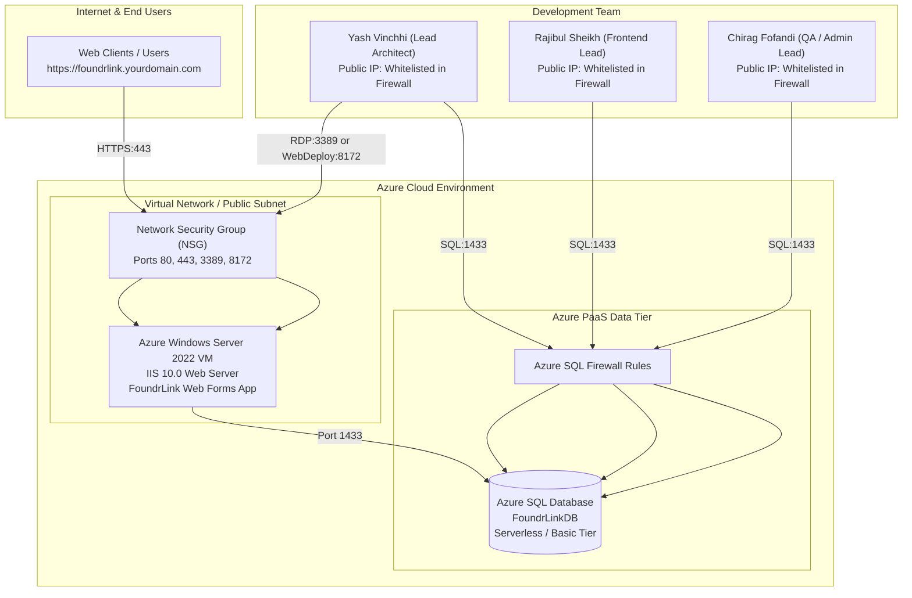

# Deployment to Azure Windows Server

This guide provides end-to-end instructions for deploying the **FoundrLink** ASP.NET Web Forms application onto an **Azure Windows Server Virtual Machine (IIS 10.0)** connected to a scalable **Azure SQL Database (PaaS)**.

---

## 1. Cloud Architecture Blueprint



---

## 2. Step 1: Provision the Azure SQL Database (PaaS)

Using Azure SQL Database provides high availability, automatic backups, and seamless firewall management:

1. **Create an Azure SQL Database:**
   - In the Azure Portal, create an **Azure SQL Database**.
   - Database name: `FoundrLinkDb`.
   - Compute tier: **Serverless (General Purpose)** with auto-pause enabled, or **Basic (5 DTUs)** for low-cost predictable testing (~$5/month).
2. **Configure Database Firewall:**
   - Enable **"Allow Azure services and resources to access this server"** (allows the Azure VM to connect).
   - Add client IP addresses for all team members so everyone can connect from SSMS or Visual Studio locally.
3. **Initialize Schema & Seed Data:**
   - Connect to the Azure SQL Server using SSMS or Azure Portal Query Editor.
   - Run the script: `Database/FoundrLink_Schema_And_Seed.sql`.

---

## 3. Step 2: Provision Windows Server 2022 VM

1. **Create Virtual Machine:**
   - Image: **Windows Server 2022 Datacenter: Azure Edition**.
   - Size: `Standard_B2s` (2 vCPUs, 4 GB RAM) — cost-effective and burstable.
2. **Network Security Group (NSG) Inbound Rules:**
   - `HTTP` (Port 80) — Allow from Any.
   - `HTTPS` (Port 443) — Allow from Any.
   - `RDP` (Port 3389) — Restricted to Team Member Public IPs.
   - `Web Deploy` (Port 8172) — Optional for one-click Visual Studio publishing.
3. **Configure DNS Label:**
   - In the VM Public IP resource, configure a DNS name label (e.g., `foundrlink.eastus.cloudapp.azure.com`).

---

## 4. Step 3: Configure IIS & ASP.NET 4.8 via PowerShell

Connect to your Windows Server VM via Remote Desktop (RDP). Open **PowerShell as Administrator** and run:

```powershell
# 1. Install IIS and ASP.NET 4.8 Web Features
Install-WindowsFeature -name Web-Server, Web-WebServer, Web-Common-Http, `
    Web-Default-Doc, Web-Dir-Browsing, Web-Http-Errors, Web-Static-Content, `
    Web-Http-Redirect, Web-App-Dev, Web-Asp-Net45, Web-Net-Ext45, `
    Web-ISAPI-Ext, Web-ISAPI-Filter, Web-Mgmt-Tools, Web-Mgmt-Console `
    -IncludeManagementTools

# 2. Install Chocolatey Package Manager
Set-ExecutionPolicy Bypass -Scope Process -Force
[System.Net.ServicePointManager]::SecurityProtocol = [System.Net.ServicePointManager]::SecurityProtocol -bor 3072
iex ((New-Object System.Net.WebClient).DownloadString('https://community.chocolatey.org/install.ps1'))

# 3. Install URL Rewrite Module (for clean routing and HTTPS redirection)
choco install urlrewrite -y

# 4. Create the Production Application Directory
New-Item -ItemType Directory -Path "C:\inetpub\foundrlink" -Force

# 5. Grant IIS AppPool Permissions for File Uploads (Images)
icacls "C:\inetpub\foundrlink" /grant "IIS_IUSRS:(OI)(CI)M" /T
icacls "C:\inetpub\foundrlink" /grant "IUSR:(OI)(CI)M" /T
```

---

## 5. Step 4: Publish & Deploy FoundrLink

### Method 1: Folder Publish + Archive Transfer (Recommended)
1. In Visual Studio, right-click the `FoundrLink` project and choose **Publish**.
2. Select **Folder** -> Specify output directory (e.g. `bin\Release\Publish\`).
3. Set Configuration to **Release - Any CPU**.
4. Click **Publish**.
5. Zip the published output files and copy them to `C:\inetpub\foundrlink\` on the server.
6. Open **IIS Manager**:
   - Point the Default Web Site physical path to `C:\inetpub\foundrlink`.
   - Ensure the Application Pool is set to **.NET CLR Version v4.0** and **Integrated Pipeline mode**.

### Method 2: Configure Production `Web.config`
Ensure the server's `Web.config` contains the Azure SQL connection string:

```xml
<connectionStrings>
  <add name="FoundrLinkDb" 
       connectionString="Server=tcp:foundrlink-sqlserver.database.windows.net,1433;Initial Catalog=FoundrLinkDb;Persist Security Info=False;User ID=foundr_admin;Password=YourSecurePassword123!;MultipleActiveResultSets=True;Encrypt=True;TrustServerCertificate=False;Connection Timeout=30;" 
       providerName="System.Data.SqlClient" />
</connectionStrings>
```

---

## 6. Step 5: Free Automated SSL/TLS Setup (`win-acme`)

To enable secure HTTPS with a valid Let's Encrypt certificate:

1. On the VM, open PowerShell and install `win-acme`:
   ```powershell
   choco install win-acme -y
   ```
2. Run `wacs.exe` from the command prompt.
3. Select:
   - `N`: Create new certificate (simple).
   - `1`: Single binding of an IIS site.
   - Choose your domain / DNS label (e.g., `foundrlink.eastus.cloudapp.azure.com`).
4. `win-acme` will automatically request the certificate, bind it to Port 443 in IIS, and install a scheduled task for automatic renewal every 60 days.

---

## 7. Cost Optimization & Auto-Shutdown Schedule

To minimize cloud costs during development and evaluation:
- **VM Auto-Shutdown:** In the Azure Portal, open your Virtual Machine -> select **Auto-shutdown** -> configure to turn off at 8:00 PM UTC daily.
- **Azure SQL Auto-Pause:** If using Azure SQL Serverless, set the **Auto-pause delay** to 1 hour. When idle, compute charges drop to $0.

---

> [!TIP]
> Working simultaneously with multiple team members on the shared database? See the **[Multi-Developer Database Workflow](Multi-Developer-Database-Workflow)** guide.
