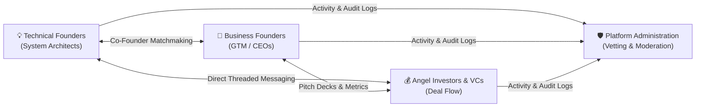

# Welcome to the FoundrLink Wiki

Welcome to the official, end-to-end technical documentation and knowledge base for **FoundrLink** — an enterprise-grade digital platform engineered to bridge the critical matchmaking gap between early-stage technical builders, business co-founders, and angel/venture capital investors.

This wiki provides comprehensive documentation covering the system's architecture, database schema, authentication & security, core user and administrative workflows, local developer onboarding, cloud deployment on Azure, and academic rubric compliance.

---

## 🎯 Executive Summary & Mission

While early-stage startup ideation is abundant globally, research demonstrates that **over 65% of high-potential ventures collapse prior to institutional financing due to co-founder disharmony, mismatched technical/business commitment, and fragmented capital discovery**.

FoundrLink addresses this friction through a unified, vetted matchmaking platform offering:
- **Multi-Dimensional Compatibility Matching:** Pairing technical builders (CTOs, system architects) with business operators (CEOs, GTM leaders) based on stage, industry, and complementary skills.
- **Structured Startup Showcase & Deal Flow:** Providing angel investors and venture capitalists with standardized startup metrics, funding goals, traction indicators, and pitch deck access.
- **Direct Real-Time Collaboration:** Threaded 1-on-1 messaging, actionable connection requests (Accept/Decline), and activity notifications.
- **Enterprise Governance & Moderation:** A full-featured Admin Console with real-time KPI metrics, user account status controls, startup listing moderation queues, and ticketed violation reporting.

---

## 📚 Wiki Table of Contents

Navigate the complete documentation using the organized categories below:

### 1. 📌 Platform Overview & Core Concepts
* **[Project Overview & Vision](Project-Overview-and-Vision)**: Problem statement, market failure analysis, target user personas, value proposition comparison (vs. LinkedIn, Wellfound, YC Matching), and operational scope.

### 2. 🏛️ Architecture & Database Design
* **[System Architecture & Tech Stack](System-Architecture-and-Tech-Stack)**: Multi-tier architectural blueprint, presentation WebForms tier, domain model, ADO.NET data access layer, Web Forms page lifecycle, and Architecture Decision Records (ADRs).
* **[Database Design & Data Dictionary](Database-Design-and-Data-Dictionary)**: Complete 14-table relational database schema, Entity-Relationship (ER) diagram, 3NF normalization, foreign key cascades, indexing strategy, and pre-seeded administrative/test credentials.

### 3. 🚀 Developer Onboarding & Setup
* **[Getting Started & Local Setup](Getting-Started-and-Local-Setup)**: System prerequisites, Visual Studio 2022/2026 installation, SQL Server LocalDB setup, connection string configuration, running with IIS Express, and verification steps.
* **[Configuration & Connection Strings](Configuration-and-Connection-Strings)**: Deep dive into `Web.config`, local development vs. Azure connection strings, secret management, and IIS settings.

### 4. 💻 Core Workflows & User Guides
* **[Authentication & Role Workflows](Authentication-and-Role-Workflows)**: User registration, role assignments (`Founder`, `Investor`, `Co-Founder`, `Admin`), secure PBKDF2 salt & hash login, and session persistence.
* **[Startup Management & Discovery](Startup-Management-and-Discovery)**: Creating and editing startup profiles (`ManageStartup.aspx`), open positions, milestone updates, and multi-faceted search & filtering (`ExploreStartups.aspx`, `StartupDetails.aspx`).
* **[Co-Founder Matchmaking & Profiles](Co-Founder-Matchmaking-and-Profiles)**: Co-founder search directory (`FindCoFounders.aspx`), skill alignment ("I Can Offer" vs. "Looking For"), user profiles (`Profile.aspx`), and connection invitations.
* **[Messaging & Notifications](Messaging-and-Notifications)**: Threaded 1-on-1 direct messaging (`Messages.aspx`), real-time unread badges, and actionable notification center (`Notifications.aspx`).

### 5. 🛡️ Administration, Security & Governance
* **[Admin Console & Moderation](Admin-Console-and-Moderation)**: Administrator dashboard (`Admin/Dashboard.aspx`), user account management (`Admin/ManageUsers.aspx`), startup review pipeline (`Admin/ManageStartups.aspx`), and report resolution (`Admin/Reports.aspx`).
* **[Security & State Management](Security-and-State-Management)**: PBKDF2 password hashing with cryptographically secure salt, SQL parameterization via ADO.NET, XSS sanitization, and Web Forms multi-level state management (ViewState, Session, Application).

### 6. ☁️ DevOps & Cloud Hosting
* **[Deployment to Azure Windows Server](Deployment-to-Azure-Windows-Server)**: Azure VM provisioning, Windows Server 2022 with IIS 10.0, Azure SQL PaaS, Web Deploy, automated SSL/TLS certificates with Let's Encrypt (`win-acme`), and cost optimization.
* **[Multi-Developer Database Workflow](Multi-Developer-Database-Workflow)**: Connecting remote team members simultaneously to a shared cloud database, IP firewall whitelisting, and schema migration etiquette.

### 7. 🎓 Academic Rubric & Viva Preparation
* **[Academic Rubric & Viva Guide](Academic-Rubric-and-Viva-Guide)**: Comprehensive alignment with CE545 course requirements (TCIE-I, TCIE-II, TSEE), OOP principles demonstration (Encapsulation, Inheritance, Polymorphism, Abstraction), .NET collections analysis, and common viva examination questions & answers.
* **[Team Work Distribution](Team-Work-Distribution)**: Roster, individual responsibilities, deliverable ownership, and mentor progress records.

### 8. ❓ Reference & Support
* **[Troubleshooting & FAQ](Troubleshooting-and-FAQ)**: Diagnosing and resolving common runtime errors, SQL connection timeouts, IIS Express port conflicts, and session expiration issues.

---

## 👥 Engineering Team & Academic Attribution

FoundrLink was developed for **CE545 — Enterprise Computing Through .NET Frameworks (Academic Year 2026–27)**.

| Team Member | Student ID | Primary Technical Specialization |
|---|---|---|
| **Yash Vinchhi** | `24CE0501` | **Lead Software Architect & Backend/Database Specialist** Database schema, ADO.NET repositories, connection pooling, domain modeling, cloud infrastructure. |
| **Rajibul Sheikh** | `24CE0502` | **Frontend Lead & ASP.NET Web Forms Designer** Master pages (`Site.Master`, `User.Master`, `Admin.Master`), CSS design system, server control lifecycle, client/server validation. |
| **Chirag Fofandi** | `24CE0503` | **QA & Security Lead / Admin & Moderation Specialist** Administration portal, SHA-256/PBKDF2 security architecture, session state management, moderation engine, viva audit. |

- **Faculty Mentor:** Prof. CE545 Project Coordinator
- **Repository:** [Rajib-AFK/FoundrLink](https://github.com/Rajib-AFK/FoundrLink)
- **Live Wiki:** [https://github.com/Rajib-AFK/FoundrLink/wiki](https://github.com/Rajib-AFK/FoundrLink/wiki)

---

> [!TIP]
> Use the persistent **Sidebar** on the right side of this wiki to quickly jump between topics at any time!
