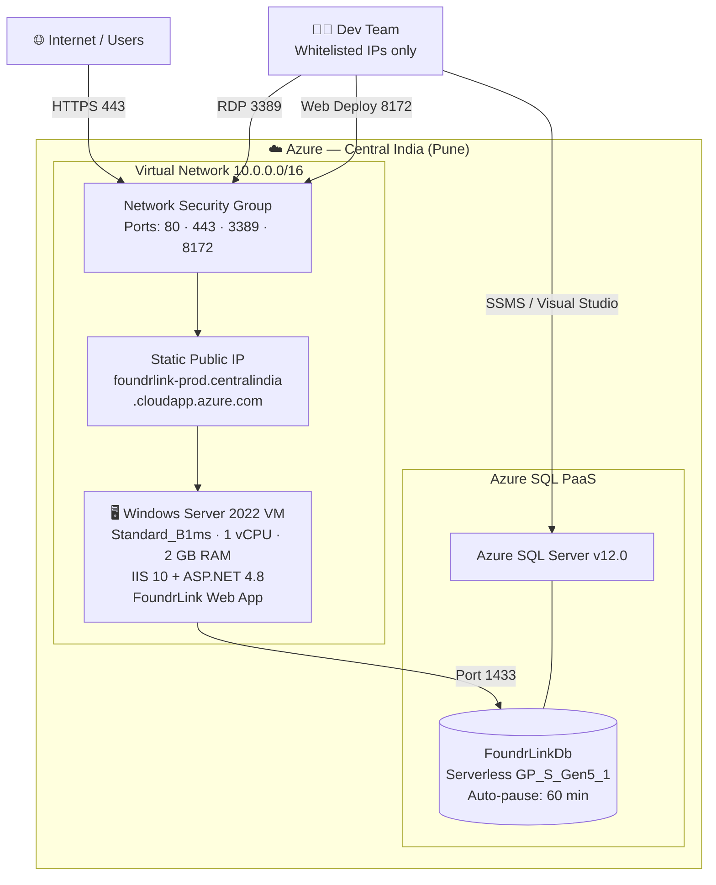

# Infrastructure as Code — Terraform on Azure

This guide covers the complete **Terraform** configuration for provisioning FoundrLink's Azure cloud infrastructure automatically using Infrastructure as Code (IaC). All Azure resources — the Windows Server VM, IIS setup, Azure SQL Database, networking, and security rules — are declared in code and reproducible with a single command.

> [!NOTE]
> This page is complementary to the **[Deployment to Azure Windows Server](Deployment-to-Azure-Windows-Server)** guide. Terraform handles provisioning infrastructure; that guide covers deploying the application onto it.

---

## 1. What is Terraform & Why Use It?

[Terraform](https://www.terraform.io/) by HashiCorp is an open-source **Infrastructure as Code (IaC)** tool. Instead of manually clicking through the Azure Portal, you declare every resource in `.tf` files — then Terraform creates, updates, or destroys infrastructure to match.

**Benefits for FoundrLink:**

| Benefit | Description |
|---|---|
| 🔁 **Reproducible** | Spin up an identical environment for dev, staging, or prod in minutes |
| 📋 **Version controlled** | Infrastructure is code — reviewed in Git like any other change |
| 💰 **Cost-aware** | Destroy everything in one command when not needed |
| 🧑‍🤝‍🧑 **Team-safe** | Anyone on the team can provision without manual Azure Portal knowledge |
| 🛡️ **Consistent security** | NSG rules, firewall whitelist, and RDP restrictions are always applied correctly |

---

## 2. Repository Layout

The Terraform configuration lives inside the project under `terraform/`:

```
FoundrLink/
└── terraform/
    ├── main.tf                    # All Azure resource definitions
    ├── variables.tf               # Typed input variable declarations
    ├── outputs.tf                 # Post-deploy output values (IP, FQDN, connection string)
    ├── terraform.tfvars.example   # Template — copy to terraform.tfvars and fill in secrets
    ├── .gitignore                 # Protects terraform.tfvars and .tfstate from git
    └── scripts/
        └── iis_setup.ps1          # PowerShell script that auto-configures IIS on the VM
```

> [!IMPORTANT]
> **Never commit `terraform.tfvars`** — it contains your passwords. It is listed in `.gitignore` automatically.

---

## 3. Cloud Architecture



---

## 4. Resources Provisioned

Every resource below is declared in [`terraform/main.tf`](https://github.com/Rajib-AFK/FoundrLink/blob/main/terraform/main.tf) and provisioned automatically by `terraform apply`:

| Resource | Azure Type | Name Pattern | Est. Cost |
|---|---|---|---|
| Resource Group | `azurerm_resource_group` | `rg-foundrlink-prod` | Free |
| Virtual Network | `azurerm_virtual_network` | `vnet-foundrlink-prod` | Free |
| Subnet | `azurerm_subnet` | `snet-web-foundrlink-prod` | Free |
| Network Security Group | `azurerm_network_security_group` | `nsg-foundrlink-prod` | Free |
| Static Public IP | `azurerm_public_ip` | `pip-foundrlink-prod` | ~\$4/mo |
| Network Interface | `azurerm_network_interface` | `nic-foundrlink-prod` | Free |
| **Windows Server 2022 VM** | `azurerm_windows_virtual_machine` | `vm-foundrlink-prod` | **~\$15/mo** |
| VM Auto-Shutdown | `azurerm_dev_test_global_vm_shutdown_schedule` | 10:30 PM IST | Saves ~40% |
| IIS Bootstrap Extension | `azurerm_virtual_machine_extension` | `iis-aspnet-setup` | Free |
| Azure SQL Server | `azurerm_mssql_server` | `sql-foundrlink-XXXXXX` | Free (PaaS) |
| SQL Firewall Rules | `azurerm_mssql_firewall_rule` | Allow Azure + Dev IPs | Free |
| **Azure SQL Database** | `azurerm_mssql_database` | `FoundrLinkDb` | **~\$0–5/mo** |
| **Total** | | | **~\$15–20/mo** |

> [!TIP]
> The Azure SQL Database uses the **Serverless** tier (`GP_S_Gen5_1`) with **auto-pause after 60 minutes of inactivity** — so you pay \$0 compute cost when no one is using the app.

---

## 5. Security Design

### Network Security Group Rules

| Rule | Port | Source | Direction | Purpose |
|---|---|---|---|---|
| `Allow-HTTP` | 80 | Any | Inbound | Public web traffic |
| `Allow-HTTPS` | 443 | Any | Inbound | Secure public web traffic |
| `Allow-RDP` | 3389 | Dev IPs only | Inbound | Remote Desktop access |
| `Allow-WebDeploy` | 8172 | Dev IPs only | Inbound | Visual Studio Web Deploy |

### Azure SQL Firewall

- **`AllowAzureServices`** — IP `0.0.0.0` → `0.0.0.0` (Azure's convention for allowing Azure-internal traffic, including the VM)
- **Per-developer rules** — each IP in `developer_ips` gets its own named firewall rule for SSMS/VS access

> [!CAUTION]
> RDP (port 3389) is **never** left open to `0.0.0.0/0`. Always supply your real public IP(s) in `rdp_allowed_ips`. Find yours at [whatismyipaddress.com](https://whatismyipaddress.com/).

---

## 6. IIS Auto-Configuration (`iis_setup.ps1`)

When Terraform provisions the VM, it automatically runs [`scripts/iis_setup.ps1`](https://github.com/Rajib-AFK/FoundrLink/blob/main/terraform/scripts/iis_setup.ps1) via Azure's **Custom Script Extension**. This script:

1. Installs IIS with all **ASP.NET 4.8** features (`Web-Asp-Net45`, `Web-Net-Ext45`, ISAPI handlers)
2. Verifies **.NET Framework 4.8** is present (Windows Server 2022 ships with it)
3. Downloads and installs **URL Rewrite 2.1** (required for HTTPS redirect rules in `Web.config`)
4. Creates the web root at `C:\inetpub\foundrlink\` with correct `IIS_IUSRS` permissions
5. Creates the **`FoundrLinkPool`** Application Pool (`.NET CLR v4.0`, Integrated Pipeline, `AlwaysRunning`)
6. Points the **Default Web Site** at `C:\inetpub\foundrlink\`
7. Enables and starts the **Web Management Service** (WMSVC) for Web Deploy
8. Opens Windows Firewall for ports 80, 443, 3389, and 8172

The script writes a detailed log to `C:\foundrlink_setup.log` on the VM for troubleshooting.

---

## 7. Input Variables Reference

All variables are defined in [`terraform/variables.tf`](https://github.com/Rajib-AFK/FoundrLink/blob/main/terraform/variables.tf):

| Variable | Default | Required | Description |
|---|---|---|---|
| `environment` | `"prod"` | No | `prod`, `staging`, or `dev` |
| `location` | `"centralindia"` | No | Azure region |
| `vm_size` | `"Standard_B1ms"` | No | VM SKU |
| `vm_admin_username` | `"foundrlink_admin"` | No | VM local admin user |
| `vm_admin_password` | — | **Yes** | Min 12 chars, upper+lower+digit+special |
| `sql_admin_username` | `"foundr_admin"` | No | Azure SQL admin user |
| `sql_admin_password` | — | **Yes** | Azure SQL admin password |
| `rdp_allowed_ips` | `[]` | **Yes** | CIDR list of IPs allowed RDP/WebDeploy |
| `developer_ips` | `[]` | No | Plain IPs whitelisted in SQL firewall |

---

## 8. Outputs Reference

After `terraform apply`, these values are printed:

| Output | Description |
|---|---|
| `resource_group_name` | `rg-foundrlink-prod` |
| `vm_public_ip` | Public IPv4 of the IIS VM |
| `vm_fqdn` | `foundrlink-prod.centralindia.cloudapp.azure.com` |
| `sql_server_fqdn` | `sql-foundrlink-XXXXXX.database.windows.net` |
| `sql_database_name` | `FoundrLinkDb` |
| `web_config_connection_string` | *(sensitive)* Ready-to-paste connection string |
| `rdp_instructions` | `mstsc.exe → <IP>:3389 → <username>` |
| `auto_shutdown_time` | `Daily at 10:30 PM IST` |

Retrieve the sensitive connection string at any time:
```powershell
terraform output web_config_connection_string
```

---

## 9. Step-by-Step Deployment

### Prerequisites

- [Terraform ≥ 1.6](https://developer.hashicorp.com/terraform/downloads) — install with `winget install HashiCorp.Terraform`
- [Azure CLI](https://learn.microsoft.com/en-us/cli/azure/install-azure-cli-windows) — install with `winget install Microsoft.AzureCLI`
- An active Azure subscription

### Step 1 — Authenticate

```powershell
az login
az account show    # Confirm correct subscription
```

### Step 2 — Configure Secrets

```powershell
cd terraform\
Copy-Item terraform.tfvars.example terraform.tfvars
# Open terraform.tfvars in any editor and fill in:
#   vm_admin_password, sql_admin_password, rdp_allowed_ips, developer_ips
```

### Step 3 — Initialise

```powershell
terraform init
```

### Step 4 — Preview

```powershell
terraform plan -out=foundrlink.tfplan
```

Review the output — expect **+15 to add, 0 to change, 0 to destroy**.

### Step 5 — Deploy

```powershell
terraform apply foundrlink.tfplan
```

> [!NOTE]
> Total provisioning time is **8–15 minutes**. The IIS bootstrap extension adds another **5–10 minutes** after the VM boots.

---

## 10. Deploying the Application After Terraform

Once `terraform apply` completes:

1. **Publish from Visual Studio:**
   - Right-click `FoundrLink` project → **Publish** → **Folder** → `bin\Release\Publish\`
   - Configuration: **Release - Any CPU**

2. **Copy to VM via RDP:**
   - RDP in: `mstsc.exe` → enter the `vm_public_ip` from Terraform output
   - Copy published files to `C:\inetpub\foundrlink\`

3. **Update `Web.config`** with the Azure SQL connection string from `terraform output web_config_connection_string`

4. **Run the schema script** in SSMS (connect to `sql_server_fqdn`):
   ```
   Database/FoundrLink_Schema_And_Seed.sql
   ```

5. **Browse** to `http://foundrlink-prod.centralindia.cloudapp.azure.com`

---

## 11. Free SSL with Let's Encrypt (`win-acme`)

On the VM via RDP, open PowerShell as Administrator:

```powershell
# Install Chocolatey
Set-ExecutionPolicy Bypass -Scope Process -Force
iex ((New-Object System.Net.WebClient).DownloadString('https://community.chocolatey.org/install.ps1'))

# Install win-acme
choco install win-acme -y

# Run the interactive wizard
wacs.exe
# Select: N (new certificate), 1 (single IIS site), choose your domain
```

`win-acme` auto-renews the certificate every 60 days via Windows Task Scheduler.

---

## 12. Cost Optimisation

| Action | Saving |
|---|---|
| VM auto-shuts down at 10:30 PM IST (configured by Terraform) | ~40% off VM cost |
| Azure SQL Serverless auto-pauses after 60 min idle | \$0 compute when not in use |
| Manually deallocate VM when not needed | 100% compute saving |

```powershell
# Manually stop + deallocate the VM (stops billing for compute)
az vm deallocate --name vm-foundrlink-prod --resource-group rg-foundrlink-prod

# Start it again
az vm start --name vm-foundrlink-prod --resource-group rg-foundrlink-prod
```

---

## 13. Tear Down

> [!CAUTION]
> `terraform destroy` **permanently deletes all resources**, including the database. Always back up production data first.

```powershell
cd terraform\
terraform destroy
```

---

## 14. Useful Commands Quick Reference

```powershell
# Show current state of all resources
terraform show

# Re-display all outputs
terraform output

# Re-display a sensitive output
terraform output web_config_connection_string

# Check if the plan would change anything
terraform plan

# VM status
az vm get-instance-view `
  --name vm-foundrlink-prod `
  --resource-group rg-foundrlink-prod `
  --query "instanceView.statuses[1]"
```

---

> [!TIP]
> Working with multiple team members? See **[Multi-Developer Database Workflow](Multi-Developer-Database-Workflow)** to whitelist each developer's IP in the Azure SQL firewall and work simultaneously on the shared cloud database.

