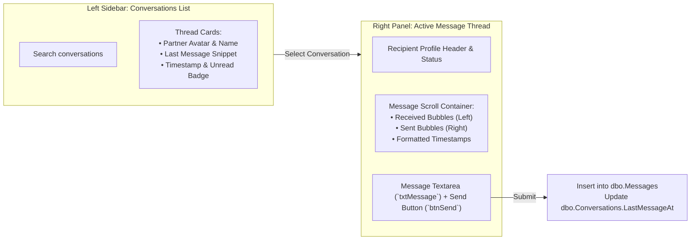

# Messaging & Notifications

FoundrLink provides real-time collaborative communication through threaded direct messaging and an actionable notification center.

---

## 1. Direct Messaging System (`Messages.aspx`)

The `Messages.aspx` interface offers a full-featured, two-pane chat workspace:



### Key Technical Implementation Details:
1. **Conversation Threading:**
   - Conversations are established between two unique users in `dbo.Conversations`.
   - The thread query fetches participants, the most recent message snippet, and an unread count:
     ```sql
     SELECT c.ConversationId, 
            CASE WHEN c.User1Id = @CurrentUserId THEN u2.FullName ELSE u1.FullName END AS PartnerName,
            CASE WHEN c.User1Id = @CurrentUserId THEN u2.AvatarUrl ELSE u1.AvatarUrl END AS PartnerAvatar,
            m.Content AS LastMessage,
            m.SentAt AS LastSentAt,
            (SELECT COUNT(1) FROM dbo.Messages WHERE ConversationId = c.ConversationId AND ReceiverId = @CurrentUserId AND IsRead = 0) AS UnreadCount
     FROM dbo.Conversations c
     INNER JOIN dbo.Users u1 ON c.User1Id = u1.UserId
     INNER JOIN dbo.Users u2 ON c.User2Id = u2.UserId
     LEFT JOIN dbo.Messages m ON m.MessageId = (
         SELECT TOP 1 MessageId FROM dbo.Messages 
         WHERE ConversationId = c.ConversationId ORDER BY SentAt DESC
     )
     WHERE c.User1Id = @CurrentUserId OR c.User2Id = @CurrentUserId
     ORDER BY c.LastMessageAt DESC;
     ```

2. **Marking Messages as Read:**
   - Selecting a conversation executes an update query:
     ```sql
     UPDATE dbo.Messages 
     SET IsRead = 1 
     WHERE ConversationId = @ConversationId AND ReceiverId = @CurrentUserId;
     ```

3. **Sending a Message:**
   - Typing a message and clicking **Send** triggers `btnSend_Click`:
     ```csharp
     protected void btnSend_Click(object sender, EventArgs e)
     {
         if (string.IsNullOrWhiteSpace(txtMessage.Text)) return;

         int currentUserId = Convert.ToInt32(Session["UserId"]);
         int conversationId = Convert.ToInt32(hfActiveConversationId.Value);
         int recipientId = Convert.ToInt32(hfRecipientId.Value);

         string insertSql = @"
             INSERT INTO dbo.Messages (ConversationId, SenderId, ReceiverId, Content, IsRead, SentAt)
             VALUES (@ConversationId, @SenderId, @ReceiverId, @Content, 0, SYSUTCDATETIME());

             UPDATE dbo.Conversations 
             SET LastMessageAt = SYSUTCDATETIME() 
             WHERE ConversationId = @ConversationId;";

         DbHelper.ExecuteNonQuery(insertSql,
             DbHelper.CreateParam("@ConversationId", SqlDbType.Int, conversationId),
             DbHelper.CreateParam("@SenderId", SqlDbType.Int, currentUserId),
             DbHelper.CreateParam("@ReceiverId", SqlDbType.Int, recipientId),
             DbHelper.CreateParam("@Content", SqlDbType.NVarChar, txtMessage.Text.Trim()));

         txtMessage.Text = string.Empty;
         LoadMessageHistory(conversationId);
     }
     ```

---

## 2. Actionable Notification Center (`Notifications.aspx`)

The `Notifications.aspx` hub organizes incoming alerts, connection invitations, and platform updates.

### Categorized Filter Tabs:
- **All Notifications:** Complete chronological stream.
- **Requests:** Connection requests requiring manual user decision (Accept / Decline).
- **Matches:** System-generated recommendations when a founder's needs match your skill matrix.
- **Activity:** Alerts on startup updates, comments, and profile views.
- **System:** Administrative announcements and verification status alerts.

### Interactive Action Hooks (Accept / Decline):
When a notification has `ActionRequired = 1`, the UI renders inline action buttons directly within the repeater:

```html
<asp:Repeater ID="rptNotifications" runat="server" OnItemCommand="rptNotifications_ItemCommand">
  <ItemTemplate>
    <div class='<%# Convert.ToBoolean(Eval("IsRead")) ? "notification-card read" : "notification-card unread" %>'>
      <div class="notification-body">
        <h4><%# Eval("Title") %></h4>
        <p><%# Eval("Message") %></p>
        <span class="timestamp"><%# Eval("CreatedAt", "{0:MMM dd, yyyy HH:mm}") %></span>
      </div>
      
      <asp:PlaceHolder ID="phActions" runat="server" Visible='<%# Eval("ActionRequired") %>'>
        <div class="notification-actions">
          <asp:Button ID="btnAccept" runat="server" Text="Accept" 
                      CssClass="btn btn-sm btn-primary" 
                      CommandName="Accept" CommandArgument='<%# Eval("NotificationId") %>' />
          <asp:Button ID="btnDecline" runat="server" Text="Decline" 
                      CssClass="btn btn-sm btn-outline" 
                      CommandName="Decline" CommandArgument='<%# Eval("NotificationId") %>' />
        </div>
      </asp:PlaceHolder>
    </div>
  </ItemTemplate>
</asp:Repeater>
```

### Global Unread Notification Counter (`User.Master.cs`):
The top navigation bar dynamically calculates the total unread count on every request:
```csharp
private void LoadUnreadNotificationCount()
{
    if (Session["UserId"] != null)
    {
        int userId = Convert.ToInt32(Session["UserId"]);
        string sql = "SELECT COUNT(1) FROM dbo.Notifications WHERE UserId = @UserId AND IsRead = 0";
        int unread = Convert.ToInt32(DbHelper.ExecuteScalar(sql, 
            DbHelper.CreateParam("@UserId", SqlDbType.Int, userId)));

        lblNotificationCount.Text = unread.ToString();
        lblNotificationCount.Visible = (unread > 0);
    }
}
```

---

> [!TIP]
> Wondering how administrators govern the platform? Proceed to **[Admin Console & Moderation](Admin-Console-and-Moderation)**.
