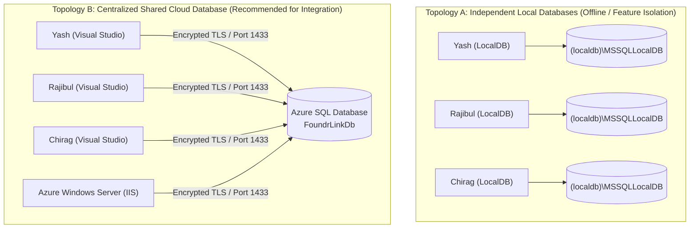

# Multi-Developer Database Workflow

When multiple engineers work simultaneously on FoundrLink, having a standardized database workflow prevents connection conflicts, schema drift, and accidental production overwrites.

---

## 1. Collaboration Topologies: Local vs. Shared Cloud



| Dimension | Topology A: LocalDB | Topology B: Shared Azure SQL |
|---|---|---|
| **Internet Dependency** | Works 100% offline | Requires stable internet connection |
| **Team Synchronization** | Requires manually running migration scripts | Live data instant sync across all teammates |
| **Testing State** | Local test records only | Real end-to-end messaging & notifications testable between machines |
| **Cloud Cost** | ₹0 / Completely Free | ~$5/month (Basic Tier) or Serverless Auto-Pause |

---

## 2. Managing Firewall Rules for Remote Developers

When using Azure SQL Database, the firewall blocks all incoming connections by default:

### Adding Team Member IPs in Azure Portal:
1. Navigate to your Azure SQL Server in the portal.
2. Under **Security**, click **Networking**.
3. Under **Firewall rules**, add rules for each team member:
   - `Rule_Yash`: Client Public IP (`xxx.xxx.xxx.xxx`)
   - `Rule_Rajibul`: Client Public IP (`yyy.yyy.yyy.yyy`)
   - `Rule_Chirag`: Client Public IP (`zzz.zzz.zzz.zzz`)
4. Ensure **"Allow Azure services and resources to access this server"** is checked so the Azure VM web server can connect.
5. Click **Save**.

---

## 3. Safe Connection String Management (No Leaked Secrets)

To allow developers to switch between LocalDB and Cloud SQL without committing credentials to Git:

### Recommended Approach: External `connectionStrings.config`
Modify `Web.config`:
```xml
<connectionStrings configSource="connectionStrings.user.config">
  <!-- Fallback placeholder; actual strings read from external file -->
</connectionStrings>
```

Create `connectionStrings.user.config` locally:
```xml
<connectionStrings>
  <add name="FoundrLinkDb" 
       connectionString="Server=tcp:foundrlink-sqlserver.database.windows.net,1433;Initial Catalog=FoundrLinkDb;Persist Security Info=False;User ID=foundr_admin;Password=SecretPassword123!;MultipleActiveResultSets=True;Encrypt=True;TrustServerCertificate=False;Connection Timeout=30;" 
       providerName="System.Data.SqlClient" />
</connectionStrings>
```

Add this pattern to `.gitignore`:
```gitignore
connectionStrings.user.config
*.user.config
```

---

## 4. Schema Migration & Collaboration Etiquette

To avoid breaking teammates' local builds when altering database tables:

1. **Never drop existing columns without communication:** Instead of deleting a column in use by another branch, mark it as deprecated or add new columns with `NULL` defaults.
2. **Version-controlled incremental scripts:** Place incremental schema modifications in `Database/Migrations/` with a numbered naming convention:
   - `001_Initial_Schema.sql`
   - `002_Add_Deadline_Month_Text.sql`
   - `003_Add_ConnectionGrowth_Table.sql`
3. **Use Idempotent SQL Scripts:** Write all DDL scripts with existence checks:
   ```sql
   IF NOT EXISTS (
       SELECT 1 FROM sys.columns 
       WHERE object_id = OBJECT_ID('dbo.Users') AND name = 'ProfileCompletionPercentage'
   )
   BEGIN
       ALTER TABLE dbo.Users ADD ProfileCompletionPercentage INT NOT NULL DEFAULT 80;
   END
   ```

---

> [!TIP]
> Preparing for academic viva evaluation? Proceed to **[Academic Rubric & Viva Guide](Academic-Rubric-and-Viva-Guide)**.
