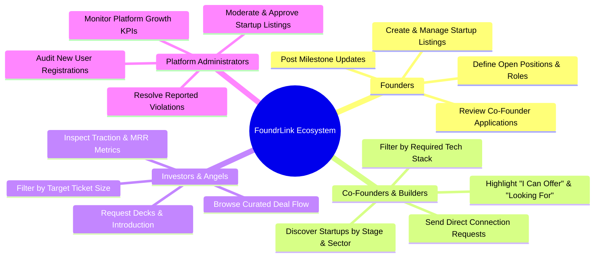

# Project Overview & Vision

## 1. Executive Summary
**FoundrLink** is a centralized, enterprise-grade digital platform engineered to bridge the critical matchmaking gap between early-stage technical builders, business co-founders, and angel/venture capital investors. While early-stage startup ideation is abundant, research consistently reveals that over 65% of high-potential ventures collapse prior to institutional financing due to co-founder misalignment and inefficient capital discovery. 

FoundrLink addresses this friction through a vetted matchmaking engine featuring multi-dimensional compatibility scoring, structured startup profiles, direct threaded messaging channels, role-based workflows, and administrative oversight. Built on Microsoft .NET Framework 4.8 and ASP.NET Web Forms, the system emphasizes robust data access via native ADO.NET, object-oriented domain modeling, and session-state persistence.

---

## 2. Problem Statement & Research Evidence

### The Real-World Problem
- **Current Situation:** Early-stage entrepreneurs rely on fragmented, generic professional social networks (e.g., LinkedIn) or noisy community forums (Reddit, Discord, WhatsApp groups) to find technical co-founders and pitch investors.
- **Specific Problem:** Existing channels lack a structured taxonomy for startup stages (Idea/Concept, Pre-Seed, Seed Stage, Series A), skill matrix matching, real-time capital commitments, and automated moderation to filter spam and speculative claims.
- **Who Experiences It:**
  1. *Technical Builders:* Engineers and architects possessing technical execution capabilities but lacking commercial, fundraising, or go-to-market (GTM) expertise.
  2. *Business Founders:* Domain experts with market insights seeking high-caliber system architects to build a viable minimum viable product (MVP).
  3. *Angel Investors & VCs:* Capital allocators overwhelmed with unvetted, unstructured pitch submissions lacking standard metrics (MRR, funding goal, team size).
- **Academic & Empirical Evidence:** Extensive research by Harvard Business School professor Noam Wasserman (*The Founder's Dilemmas*) demonstrates that **65% of early-stage venture collapses stem from co-founder team disharmony** and mismatched technical/business commitment.
- **Consequences of Leaving It Unresolved:** Prolonged search cycles, suboptimal founder partnerships, wasted seed capital, and delayed commercialization of viable innovations.

---

## 3. Target User Personas & Stakeholder Analysis

| Stakeholder Persona | Key Needs | Pain Points | Primary System Usage |
|---|---|---|---|
| **Founders** | Visibility for startup, finding complementary technical/operational talent, discovering active seed investors. | High noise-to-signal ratio on generic social platforms; cold outreach often ignored. | Create & manage startup listings, publish team needs, request introductions, review applicant profiles. |
| **Co-Founders / Builders** | Finding vetted early-stage startups with genuine traction, equity transparency, and compatible culture. | Unclear commitment expectations; difficulty assessing founder credibility. | Browse startups by industry and required skills; connect directly with founders; showcase skill portfolios. |
| **Investors** | Curated deal flow, verified founder credentials, stage-appropriate check sizes, and clear traction metrics. | Overwhelmed inbox with spam; lack of standardized metrics in informal pitches. | Filter startups by sector/stage; evaluate problem-solution statements; request pitch decks and schedule meetings. |
| **Platform Admins** | Quality assurance, user verification, compliance monitoring, and platform growth metrics. | Fraudulent pitch submissions; abusive direct outreach; duplicate accounts. | Supervise registration queue, review startup submissions, resolve reported violations (#RPT-xxx), track operational KPIs. |

---

## 4. Competitive Analysis & Value Proposition

| Platform | Strengths | Critical Limitations | FoundrLink Value Proposition |
|---|---|---|---|
| **LinkedIn** | Massive professional user base; broad career history. | Generic networking; lack of startup funding metrics, stage filtering, or co-founder skill alignment algorithms. | Purpose-built startup profile schemas with Funding Raised/Goal and MRR tracking. |
| **Wellfound (formerly AngelList Talent)** | Tech job listings and candidate matching. | Heavy pivot toward established mid-market tech hiring rather than formative co-founder equity matchmaking. | High-touch matchmaking cards with explicit "Commitment" (Full-time / Equity) and "I Can Offer / Looking For" dimensions. |
| **Y Combinator Co-Founder Matching** | Exclusive co-founder candidate directory. | Walled garden restricted primarily to YC applicant cohorts; lacks integrated investor deck request workflow. | Open, structured application process with multi-faceted filtering (Industry, Stage, Skill, Team Size). |

---

## 5. System Scope

### ✅ In-Scope Features
1. **Curated Public Discovery & Portals:**
   - Landing page with verified platform statistics (12,000+ vetted founders, ₹4.2Cr capital deployed, 850+ active funds).
   - "Actively Raising" showcase cards with direct "Request Deck" capabilities.
   - Self-service registration and authentication with cryptographic security.
2. **Member Collaboration Workspace:**
   - Interactive user dashboard with connection growth metrics and deadline tracking.
   - Comprehensive startup profile lifecycle (Create, edit, manage open positions, post updates).
   - Multi-faceted startup directory with stage, industry, and keyword search filters.
   - Co-founder discovery directory with skill tags and availability indicators.
   - Direct 1-on-1 threaded messaging system with read status tracking.
   - Actionable notification center supporting connection requests with inline Accept/Decline actions.
   - User account profile customization with "I Can Offer" and "Looking For" matrices.
3. **Enterprise Administration Console:**
   - Real-time operational dashboard with key metric counters.
   - User status management (Active, Pending, Suspended).
   - Startup moderation queue (Approve, Reject, Under Review).
   - Report ticketing center with priority triage (High, Medium, Low).

### ❌ Out-of-Scope (Deliberate Design Boundaries)
- **Live Escrow Payment Settlement:** Financial transactions are represented via recorded funding goals and commitments rather than direct third-party payment gateways (Razorpay/Stripe).
- **Third-Party OAuth Providers:** Focused on robust, self-contained enterprise credential security using PBKDF2/SHA-256 password hashing.
- **Real-Time WebSocket Servers:** Real-time behavior is achieved using clean ASP.NET Web Forms postbacks, AJAX update patterns, and session-state synchronization.

---

> [!NOTE]
> Proceed to **[System Architecture & Tech Stack](System-Architecture-and-Tech-Stack)** to understand how these requirements translate into our multi-tier architecture.
