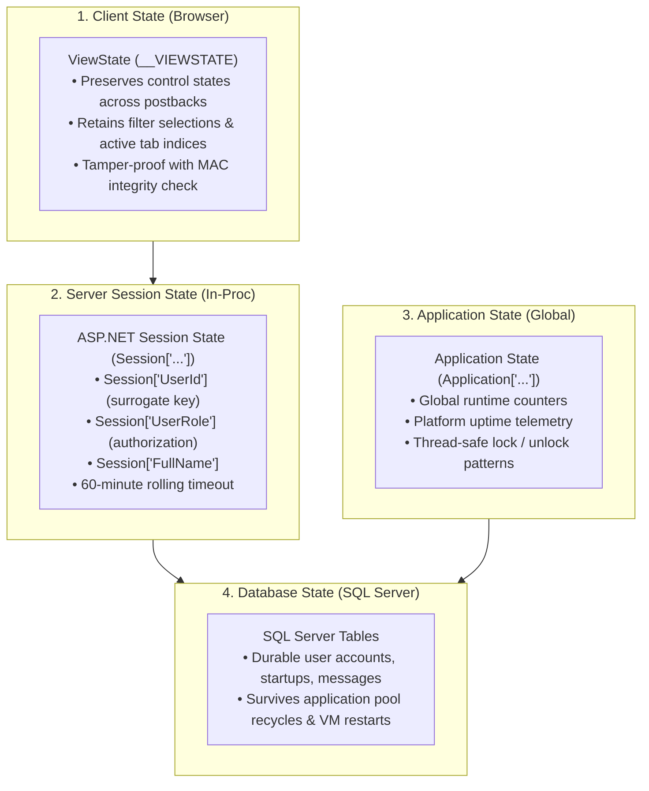

# Security & State Management

FoundrLink adheres to strict enterprise security standards, safeguarding user credentials, preventing common web vulnerabilities, and managing runtime application state across distinct architectural tiers.

---

## 1. Cryptographic Password Architecture

FoundrLink employs **PBKDF2 (Password-Based Key Derivation Function 2)** with salted cryptographic hashes implemented in [`Helpers/SecurityHelper.cs`](file:///D:/dotnet/Foundrlink_new/FoundrLink/Helpers/SecurityHelper.cs).

### Cryptographic Parameters:
- **Salt Size:** 16 bytes (128 bits) generated via `RNGCryptoServiceProvider`.
- **Hash Size:** 32 bytes (256 bits).
- **Iteration Count:** 10,000 iterations using HMAC-SHA1/SHA256.
- **Serialization Format:** `{iterations}.{base64Salt}.{base64Hash}`.

```csharp
public static string HashPassword(string password)
{
    if (string.IsNullOrEmpty(password))
        throw new ArgumentNullException(nameof(password));

    using (var rng = new RNGCryptoServiceProvider())
    {
        byte[] salt = new byte[SaltSize];
        rng.GetBytes(salt); // Generate cryptographically secure pseudorandom salt

        using (var pbkdf2 = new Rfc2898DeriveBytes(password, salt, Iterations))
        {
            byte[] hash = pbkdf2.GetBytes(HashSize);
            return $"{Iterations}.{Convert.ToBase64String(salt)}.{Convert.ToBase64String(hash)}";
        }
    }
}
```

### Constant-Time Verification (Mitigating Timing Attacks):
To prevent timing side-channel attacks where an attacker deduces hash bytes by measuring subtle microsecond response discrepancies, `SecurityHelper` uses bitwise XOR comparison:

```csharp
private static bool SlowEquals(byte[] a, byte[] b)
{
    uint diff = (uint)a.Length ^ (uint)b.Length;
    for (int i = 0; i < a.Length && i < b.Length; i++)
    {
        diff |= (uint)(a[i] ^ b[i]);
    }
    return diff == 0;
}
```

---

## 2. SQL Injection Prevention via Parameterization

All database queries across the application utilize **parameterized `SqlCommand` objects**. Zero dynamic SQL string concatenation is permitted.

```csharp
// SECURE: Parameterized query via DbHelper
string query = "SELECT UserId, FullName FROM dbo.Users WHERE Email = @Email AND Status = @Status";

DataTable dt = DbHelper.ExecuteDataTable(query,
    DbHelper.CreateParam("@Email", SqlDbType.NVarChar, email),
    DbHelper.CreateParam("@Status", SqlDbType.NVarChar, "Active")
);
```

### Why this is impenetrable to SQL Injection:
- User inputs (`email`, `status`) are never concatenated into the query text.
- The SQL Server database engine parses and compiles the query execution tree before the parameter values are bound.
- Malicious payloads (e.g. `' OR '1'='1`) are treated strictly as string literals, not executable SQL syntax.

---

## 3. Cross-Site Scripting (XSS) & Input Sanitization

- **ASP.NET Request Validation:** Built-in validation actively checks for HTML tags and script fragments in form POST payloads, rejecting potentially dangerous content.
- **HTML Encoding on Output:** Dynamic text rendered through data-binding expressions is wrapped using `HttpUtility.HtmlEncode()` or native ASP.NET server controls (which encode by default), neutralizing malicious script injection (`<script>alert(1)</script>`).
- **File Upload Restrictions:** Profile image uploads in `ManageStartup.aspx` and `Profile.aspx` validate MIME types and file extensions (`.png`, `.jpg`, `.jpeg`, `.svg`), enforcing a strict 10 MB limit to prevent denial-of-service (DoS) or arbitrary file upload vulnerabilities.

---

## 4. Layered State Management Architecture

FoundrLink balances performance, scalability, and security through a four-tiered state management model:



| State Tier | Mechanism | Scope | Data Maintained | Lifetime |
|---|---|---|---|---|
| **Page / Control** | ViewState | Single Page | Filter selections, grid sort order, modal visibility | Lost upon navigating away |
| **User Session** | In-Proc Session | Authenticated User | `UserId`, `FullName`, `UserRole`, `AvatarUrl` | 60 minutes of inactivity |
| **System Application** | `HttpApplicationState` | Global (All Users) | Uptime timestamp, connected user counts | Entire server process life |
| **Persistent Storage** | SQL Server (LocalDB / Azure) | Permanent | User accounts, startups, messages, reports | Permanent (survives restarts) |

---

> [!TIP]
> Preparing for production deployment? Read the **[Deployment to Azure Windows Server](Deployment-to-Azure-Windows-Server)** guide next.
