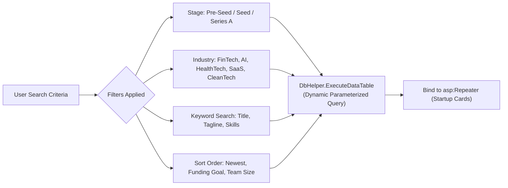
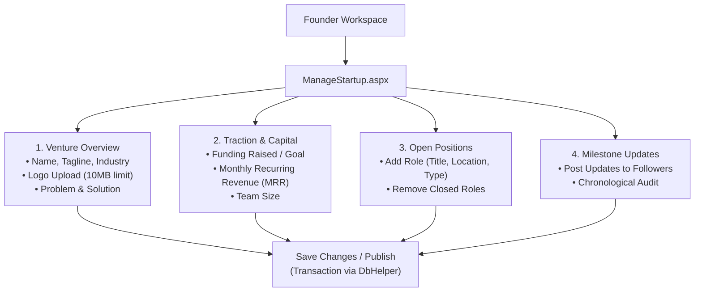

# Startup Management & Discovery

FoundrLink provides a structured, rich ecosystem for showcasing startup ventures, managing team requirements, and discovering high-potential investment deal flow.

---

## 1. Startup Exploration & Multi-Faceted Filtering (`ExploreStartups.aspx`)

The `ExploreStartups.aspx` page allows investors and prospective co-founders to explore curated startups using faceted search parameters:



### Supported Filter Dimensions:
1. **Industry Sectors:** FinTech, HealthTech, AI / ML, SaaS, EdTech, CleanTech, E-Commerce, DevTools.
2. **Growth Stages:**
   - `Idea / Concept`: Early ideation seeking initial technical validation.
   - `Pre-Seed`: Formative prototype stage; seeking first co-founder or angel capital.
   - `Seed Stage`: Operational MVP with early traction and active fundraising target.
   - `Series A`: Scaling enterprise with verified recurring revenue (MRR).
3. **Sorting Options:**
   - *Newest First* (`CreatedAt DESC`)
   - *Highest Funding Target* (`FundingGoal DESC`)
   - *Largest Team* (`TeamSize DESC`)

### Dynamic SQL Query Construction (`ExploreStartups.aspx.cs`):
```csharp
private void LoadStartups()
{
    var sql = new StringBuilder(@"
        SELECT s.StartupId, s.Name, s.Tagline, s.Industry, s.Stage, s.LogoUrl,
               s.Location, s.TeamSize, s.FundingRaised, s.FundingGoal, s.MRR,
               u.FullName AS FounderName, u.AvatarUrl AS FounderAvatar
        FROM dbo.Startups s
        INNER JOIN dbo.Users u ON s.FounderId = u.UserId
        WHERE s.Status IN ('Active', 'Approved')");

    var parameters = new List<SqlParameter>();

    // Keyword Filter
    if (!string.IsNullOrWhiteSpace(txtSearch.Text))
    {
        sql.Append(" AND (s.Name LIKE @Search OR s.Tagline LIKE @Search OR s.RequiredSkills LIKE @Search)");
        parameters.Add(DbHelper.CreateParam("@Search", SqlDbType.NVarChar, "%" + txtSearch.Text.Trim() + "%"));
    }

    // Industry Filter
    if (ddlIndustry.SelectedValue != "All" && !string.IsNullOrEmpty(ddlIndustry.SelectedValue))
    {
        sql.Append(" AND s.Industry = @Industry");
        parameters.Add(DbHelper.CreateParam("@Industry", SqlDbType.NVarChar, ddlIndustry.SelectedValue));
    }

    // Stage Filter
    if (ddlStage.SelectedValue != "All" && !string.IsNullOrEmpty(ddlStage.SelectedValue))
    {
        sql.Append(" AND s.Stage = @Stage");
        parameters.Add(DbHelper.CreateParam("@Stage", SqlDbType.NVarChar, ddlStage.SelectedValue));
    }

    // Dynamic Sort Order
    switch (ddlSort.SelectedValue)
    {
        case "GoalDesc": sql.Append(" ORDER BY s.FundingGoal DESC"); break;
        case "TeamSize": sql.Append(" ORDER BY s.TeamSize DESC"); break;
        default: sql.Append(" ORDER BY s.CreatedAt DESC"); break;
    }

    DataTable dt = DbHelper.ExecuteDataTable(sql.ToString(), parameters.ToArray());
    rptStartups.DataSource = dt;
    rptStartups.DataBind();
}
```

---

## 2. Interactive Startup Profile (`StartupDetails.aspx`)

Clicking any card in the startup catalog loads `StartupDetails.aspx?id={StartupId}`:

### Profile Sections:
1. **Header & Metrics Summary:**
   - Startup name, verified badge, industry badge, and stage pill.
   - Key Metrics Cards: Headcount (`TeamSize`), Founded Year (`FoundedYear`), Location (`Location`), Monthly Recurring Revenue (`MRR`).
2. **Funding Progress Visualizer:**
   - Computes progress percentage dynamically:
     $$\text{Funding Progress (\%)} = \min\left(100, \left(\frac{\text{FundingRaised}}{\text{FundingGoal}}\right) \times 100\right)$$
   - Displays animated CSS progress bar with raised vs. target amounts.
3. **Problem & Solution Breakdown:**
   - Structured panels outlining the core market friction and how the product solves it.
4. **Open Positions Section:**
   - Binds to `dbo.OpenPositions`.
   - Each role card showcases Title, Location (e.g. Remote), Type (Full-time / Equity), and a "Request to Join" button.
5. **Team Members & Leadership:**
   - Binds to `dbo.TeamMembers`, displaying avatar, name, and role.
6. **Company Updates & Milestones:**
   - Binds to `dbo.StartupUpdates`, displaying chronological updates published by the founder.

---

## 3. Startup Management Console (`ManageStartup.aspx`)

Founders manage their venture's complete digital presence via `ManageStartup.aspx`:



### Core Operations Supported:
- **Create New Listing:** Initializes a startup record linked to `Session["UserId"]`. Status defaults to `Under Review` or `Active`.
- **Edit Existing Listing:** Populates form controls with current database values during `!IsPostBack`.
- **Logo Upload Management:** Accepts `.png`, `.jpg`, `.svg` files up to 10 MB, saves to `~/Images/Logos/`, and stores the relative URL in `LogoUrl`.
- **Add Open Position:** Submits a new row into `dbo.OpenPositions` associated with the active `StartupId`.
- **Post Milestone Update:** Submits an update entry into `dbo.StartupUpdates`.
- **Delete Startup:** Cascades deletion across all associated open positions, team members, and updates with a confirmation modal.

---

> [!TIP]
> Looking for the right technical partner? See how talent matching works in **[Co-Founder Matchmaking & Profiles](Co-Founder-Matchmaking-and-Profiles)**.
