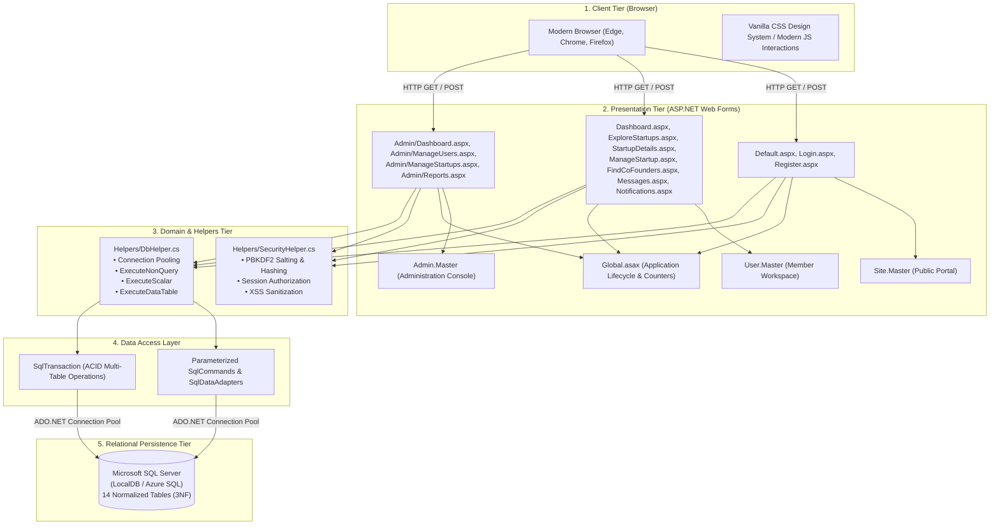
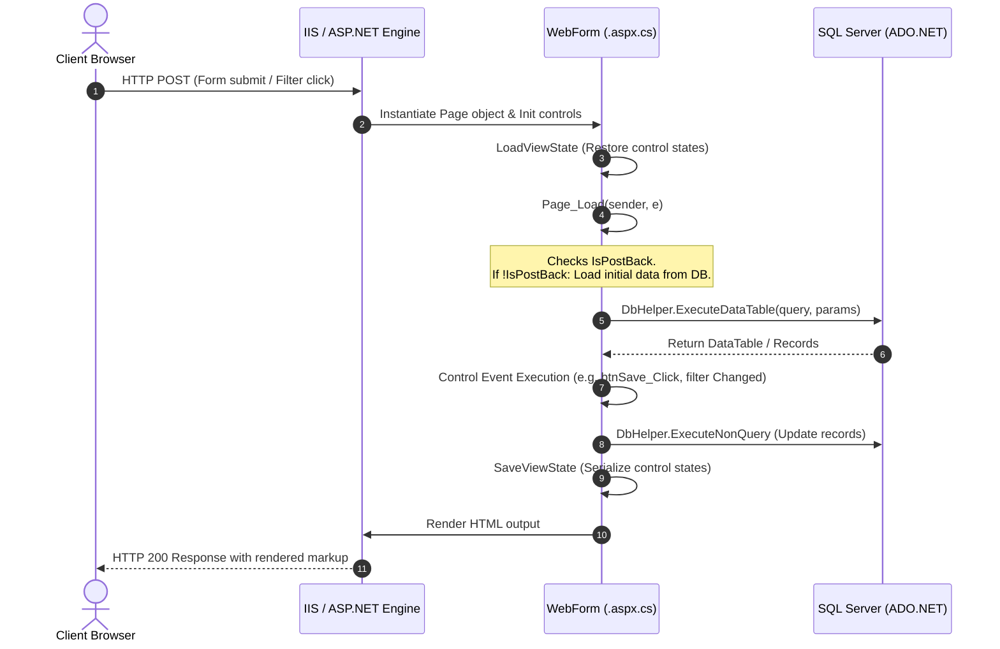

# System Architecture & Tech Stack

## 1. Architectural Baseline & Specifications

FoundrLink is built on Microsoft's enterprise-grade application stack, designed around high cohesion, low coupling, and strict separation of concerns across tiers:

- **Target Framework:** Microsoft .NET Framework 4.8 / 4.7.2
- **Application Paradigm:** Classic ASP.NET Web Forms
- **Database Engine:** Microsoft SQL Server (LocalDB `(localdb)\MSSQLLocalDB` / Azure SQL Database)
- **Data Access Pattern:** Native ADO.NET with Parameterized Queries & `DbHelper` Abstraction
- **Web Server Host:** IIS 10.0 (Windows Server 2022) / IIS Express 10.0 (Local Dev)
- **Security & Cryptography:** PBKDF2 with Cryptographic Salt (10,000 iterations) + Legacy SHA-256 fallback
- **State Management:** Layered State Architecture (ViewState, Session, Application, SQL Server)

---

## 2. Multi-Tier Architecture Diagram

---

## 3. Tier Responsibilities & Component Inventory

| Tier | Component / File | Purpose & Responsibilities |
|---|---|---|
| **Presentation Tier** | `Site.Master` | Public-facing master layout with hero headers, navigation, and marketing footer. |
| **Presentation Tier** | `User.Master` | Authenticated member layout with collapsible sidebar, active route indicators, user avatar dropdown, and unread notification counter. |
| **Presentation Tier** | `Admin.Master` | Administrative console layout featuring enterprise branding, quick search, system alerts, and moderation sub-menus. |
| **Presentation Tier** | Web Forms (`.aspx` + `.aspx.cs`) | UI markup declaration, server control bindings (`asp:Repeater`, `asp:GridView`, `asp:Button`), postback event dispatching, ViewState retention. |
| **Domain & Security Tier** | `SecurityHelper.cs` | Cryptographic password generation, PBKDF2 comparison, authentication session validation (`IsUserLoggedIn`, `GetCurrentUserId`), and role checking. |
| **Data Access Tier** | `DbHelper.cs` | High-performance ADO.NET helper encapsulating connection lifetimes, parameterized queries, and safe `DataTable`/scalar consumption. |
| **Persistence Tier** | `FoundrLinkDB` | Microsoft SQL Server database hosting 14 normalized tables, foreign key constraints, unique constraints, and cascade delete rules. |

---

## 4. ASP.NET Web Forms Page Lifecycle in FoundrLink

Understanding the page lifecycle is critical when building and extending FoundrLink pages:

### Key Lifecycle Principles Followed:
1. **`!IsPostBack` Guarding:** Initial database binding queries (e.g., binding startup details or grid data) are enclosed in `if (!IsPostBack)` blocks to prevent redundant database fetches during button clicks or pagination.
2. **ViewState Preservation:** Control states such as selected filter categories, search terms, and active tab index are preserved seamlessly across postbacks via Web Forms ViewState.
3. **Session State Protection:** Protected pages (`Dashboard.aspx`, `ManageStartup.aspx`, `Messages.aspx`, etc.) verify `SecurityHelper.IsUserLoggedIn()` inside `Page_Load`. If the session has expired or is invalid, the request is redirected to `/Login.aspx?returnUrl=...`.

---

## 5. Architecture Decision Records (ADRs)

### ADR-001: Selection of Classic ASP.NET Web Forms over ASP.NET Core
- **Status:** Approved
- **Context:** The CE545 course curriculum mandates deep mastery of Microsoft .NET Framework architectures, including Master Pages, Server Controls, Page Life Cycle, and ViewState.
- **Decision:** Build the entire user and admin experience using ASP.NET Web Forms on .NET Framework 4.8.
- **Consequences:** Provides granular control over page events, built-in validation controls (`RequiredFieldValidator`), and state preservation without requiring external Single Page Application (SPA) frameworks.

### ADR-002: Native ADO.NET over Entity Framework (EF)
- **Status:** Approved
- **Context:** High throughput, explicit SQL control, zero ORM overhead, and educational demonstration of low-level SQL connection pooling, transactions, and parameterization.
- **Decision:** Implement database interaction using native `System.Data.SqlClient` with centralized execution through `DbHelper.cs`.
- **Consequences:** Eliminates hidden N+1 query problems, guarantees 100% parameterized queries, and provides optimal execution speed on both local SQL Server LocalDB and Azure SQL.

### ADR-003: Salted PBKDF2 Password Hashing
- **Status:** Approved
- **Context:** Storing plaintext or unsalted passwords creates catastrophic security vulnerabilities.
- **Decision:** Use PBKDF2 (`Rfc2898DeriveBytes`) with a 16-byte cryptographically random salt generated via `RNGCryptoServiceProvider` and 10,000 iterations.
- **Format:** `{Iterations}.{Base64Salt}.{Base64Hash}`. Legacy SHA-256 hashes are automatically recognized for backward compatibility.

---

> [!TIP]
> Next, inspect the **[Database Design & Data Dictionary](Database-Design-and-Data-Dictionary)** to explore the 14-table schema and relational models.
